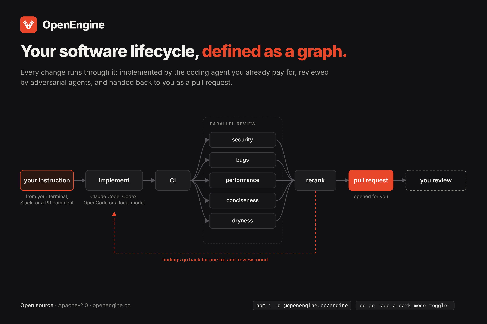

# OpenEngine

[](https://github.com/OpenEngine/OpenEngine/actions/workflows/tests.yml)
[](https://join.slack.com/t/openenginegroup/shared_invite/zt-49mkaebkz-m86SbPAwn_QNMPqsSgioYQ)
[](https://openengine.cc/docs/)

OpenEngine is a graph execution engine that meets you where you work.



We give you an out-of-the-box configuration to get you up and running. The out-of-the-box graph lives [here](./workflows/implementation_review_graph.py) and looks like this:
```
Implement -> Pool of Reviewers -> Reranking (Reduces noise) ->  Safe change 
```
## Getting started

Install the CLI, then run it from inside any git repository. For a local backend,
[set up SmolVM and its guest image](docs/sandbox.md) first; graph agents default
to VMs. Unsupported hosts must explicitly select `engine vm use process`:

```bash
npm i -g @openengine.cc/engine
cd your-repo
engine go "add a dark mode toggle to the settings page"
```
Or try it without installing:
```
npx @openengine.cc/engine go "add a dark mode toggle to the settings page"
```
If you installed earlier with the curl installer, npm will refuse to overwrite its `~/.local/bin/engine` launcher. Run `npm i -g --force @openengine.cc/engine` once to replace it.
`engine go` runs the default graph: implement, check CI, review the change from several angles, fix what the review finds, and open a pull request. It follows the run live in your terminal. The first time you run it in a repository, it asks whether to trust it; trusted repositories run without stopping for approvals.

Stuck, or just want to say hello? Join us on [Slack](https://join.slack.com/t/openenginegroup/shared_invite/zt-49mkaebkz-m86SbPAwn_QNMPqsSgioYQ).

## Basics

### Graphs

A graph is a workflow of agent and code steps. Use the built-in ones, or write your own (YAML or Python) to automate the tedious parts of your development process.
```
engine graphs                                   # list available graphs
engine go review <pr-url>                       # review an existing pull request
engine go fix <pr-url>                          # address its unresolved review comments
engine graph add my-graph.yaml                  # register your own graph
engine graph run my-graph "add my widget"       # run any graph with an instruction
```
### Steering

Runs are steerable while they work. Watch one, then redirect a node mid-flight:
```
engine run watch <run-id>
engine node steer <execution-id> "use the existing date helper instead"
```
### Loops

Loops run a graph on a schedule: QA sweeps, pentesting, dependency upkeep, or anything else you'd want done every day. Each loop has limits, so it can't run away with your budget.
```
engine loop add qa-sweep --every 1d --max-spend 20 --max-prs 5
engine loops                                    # status, spend and PRs per loop
```
### From source

To do work on OpenEngine. Requires [uv](https://docs.astral.sh/uv/), Python 3.11+, and Node.js 20.19+.

First, clone the repo:
```bash
cd OpenEngine
uv sync --all-packages  # install all workspace packages, editable
npm --prefix apps/web install
npm --prefix apps/web run build
```
Graph agents default to SmolVM on Apple Silicon macOS and Linux KVM. Follow
[the sandbox setup](docs/sandbox.md) to install SmolVM and select a built guest
image. To use host processes instead, explicitly set `[sandbox] backend =
"process"` in your configuration (or run `engine vm use process`). Concierges
and the scoper continue running on the host.

Then, run it by pointing it at your directory:
```bash
uv run \
  --project /path/to/openengine \
  --directory /path/to/your/project \
  --all-packages \
  engine-web
```
Or install the checked-out commit as your `engine`, in place of a release,
exactly as the one-line installer would. It is labeled with the commit, such as
`1.2.0-ffdb7cd`, and takes the installer's options:
```bash
scripts/install-local.sh --no-start
# Configure SmolVM and its image (or explicitly select process), then:
engine daemon setup
```
The production service defaults to `http://127.0.0.1:4364`. Verify its identity
and readiness after startup:
```bash
curl --fail http://127.0.0.1:4364/api/health
# {"service":"openengine","version":"0.0.0","ready":true,"api_version":1}
```
`version` is the installed `engine-web` package version. Health returns HTTP 503
until startup completes, if the configured graph runtime cannot open, or during
shutdown; otherwise it returns HTTP 200. This public endpoint requires no browser
login and does not check external provider credentials.

## Terminal commands

The binary is `engine`. Run it with no arguments to list its commands:

- `engine daemon` runs the local service in the background; see
  [Background service](docs/releases.md#background-service).
- `engine connect gh|github|gitlab|slack` connects the selected backend's shared
  source control or Slack; `engine connections` shows them and
  `engine disconnect` undoes one.
- `engine agent add|get|remove|signin` and `engine agents` manage the agents
  graphs name: the built-in `claude`, `codex` and `opencode`, and any you add,
  such as `engine agent add opencode --name qwen --model qwen3-coder --url http://gpu.local:8000/v1`.
- `engine agent claude`, `engine agent codex` and `engine agent opencode`
  start a run whose implementation node is that CLI in this terminal: the
  daemon checks the repository out into a fresh workspace and gives the agent
  the same `git_subcommand` and `open_pull_request` tools an implementation
  node gets (`[sessions] tools` in `engine.toml` changes which). The run ends
  when the CLI exits. Arguments after `--` go to the CLI.
- `engine graph`, `engine run`, `engine loop`, `engine node` and their list
  forms (`graphs`, `loops`, `nodes`) register, execute, schedule and steer
  graphs; `engine backend` chooses which daemon they talk to. See
  [cli/README.md](cli/README.md).

While working on OpenEngine itself, run the development server instead:
```bash
uv run engine-dev
```

## engine.toml
The main configuration file for OpenEngine. It's defined [here](./engine.toml).
While we use sensible defaults, if you need to configure engine, point it at a new 
`engine.toml` file.
```
uv run \
  --project /path/to/openengine \
  --directory /path/to/your/project \
  --all-packages \
  engine-web \
  --config /path/to/engine.toml
```

SQLite and PostgreSQL have independent Alembic histories. The PostgreSQL
history is currently a placeholder; the SQLite state store upgrades its
database on startup and can also be upgraded explicitly:

```bash
DATABASE_URL=sqlite:///conversations.sqlite3 uv run engine-migrate ## you shouldn't have to run this, happens automatically on startup
```

## GitHub connection

OpenEngine connects to GitHub to open pull requests and post review comments. The easiest method is to use the gh cli. 
The connection is set up once per machine through the Settings panel (gear icon
at the bottom of the sidebar).

### One-time setup: register an OAuth App

You need to create one GitHub OAuth App for your team. Each colleague then
pastes the client ID into their own Settings panel — no secrets are shared and
no server configuration is required beyond the step below.

1. Go to **github.com → Settings → Developer settings → OAuth Apps → New OAuth App**
2. Fill in the form (device flow does not use the callback URL, but GitHub
   requires one):
   - **Application name:** `OpenEngine`
   - **Homepage URL:** `http://localhost:4364`
   - **Authorization callback URL:** `http://localhost:4364`
3. Click **Register application**
4. On the app page, check **Enable Device Flow** and click **Update application**
5. Copy the **Client ID** (looks like `Ov23liXXXXXXXXXX`)

### Connecting

1. Open the Settings panel (gear icon in the sidebar)
2. Paste the Client ID into the field and click **Save**
3. Click **Connect GitHub**
4. The panel shows a short code and a link to **github.com/login/device**
5. Open that link, enter the code, click **Authorize**
6. The panel switches to **Connected** automatically

The OAuth token set is stored in the OS keychain (macOS Keychain, Secret
Service on Linux, Windows Credential Manager). When GitHub issues expiring
tokens, OpenEngine refreshes them automatically after an authorization failure
and retries the interrupted GitHub request once. Each colleague repeats steps
1–6 once with the same client ID.

## GitLab connection

OpenEngine can also connect to GitLab through OAuth. GitLab.com and each
self-managed instance have separate OAuth applications and credentials, so
create an application on the instance you intend to use.

### One-time setup: register an OAuth application

1. In GitLab, open **Avatar → Edit profile → Access → Applications**, then
   select **Add new application**.
2. Fill in the application:
   - **Name:** `OpenEngine`
   - **Redirect URI:** `http://localhost:7171/auth/redirect` (the device flow
     does not use it, but GitLab may require a value when registering the app)
   - **Scopes:** `api`
   - **Confidential:** leave unchecked
   - **Allowed grant types:** enable `device_code`
3. Save the application and copy its **Application ID**. Do not put the Client
   Secret into OpenEngine; the device flow uses only the Application ID.

### Connecting

1. Open the Settings panel and select **GitLab OAuth**.
2. Enter the instance URL. For GitLab.com, use `https://gitlab.com` — not a
   group or project URL.
3. Paste the Application ID and select **Save GitLab client ID**.
4. Select **Connect GitLab**. Open the displayed GitLab link and enter the
   device code displayed in OpenEngine. A phone is not required; the browser
   can be on the same computer.
5. GitLab confirms authorization and OpenEngine switches to **Connected**
   after its next poll.

The token pair is stored in the OS keychain per GitLab instance. OpenEngine
refreshes an expired access token once after an authorization failure, persists
the rotated credential pair, and retries the interrupted API request once.

For self-managed GitLab, device authorization requires GitLab 17.9 or later
and a public OAuth application with the `device_code` grant enabled. See
[GitLab's OAuth documentation](https://docs.gitlab.com/api/oauth2/) for
instance-specific configuration.

### Environment variable fallback

If you deploy OpenEngine on a server where no keychain is available, set the
client ID and a pre-generated token as environment variables instead:

```toml
# engine.toml
github_client_id = "Ov23liXXXXXXXXXX"
github_token     = "ghp_XXXXXXXXXXXX"
```

Or via environment variables:

```bash
GITHUB_CLIENT_ID=Ov23liXXXXXXXXXX GITHUB_TOKEN=ghp_XXXXXXXXXXXX uv run engine-web
```

For browser-based login setup, see the [GitHub login guide](docs/github-login.md).
To receive comments and merges from GitHub, see the
[GitHub webhooks guide](docs/github-webhooks.md).
Add a local checkout with `engine repo add .`, or clone a GitHub/GitLab project with `engine repo add https://github.com/owner/repo`.
It checks prerequisites, clones the repository, saves configuration, and makes
it available immediately without restarting. The web UI's **Add repository**
action and MCP's `onboard_repository` tool provide the same onboarding.
See [repository onboarding](docs/repository-onboarding.md) for options and the
manual configuration reference.
