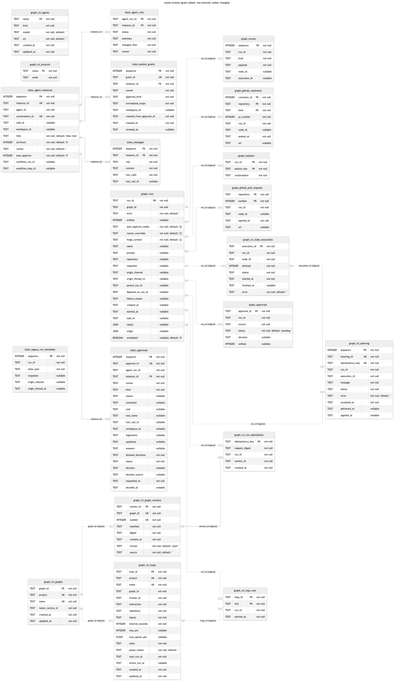

# Latest database schema



The workflow writes [schema.mermaid](schema.mermaid) and [schema.png](schema.png)
together when the schema comparison changes. It migrates empty SQLite databases
to all current heads and compares their tables, columns, keys, defaults, indexes
and constraints with the PR base. Pushes without an open PR use the preceding
commit; manual runs without a PR compare with the same commit.

Green tables are added, red tables are removed, and amber tables changed.
Column annotations mark ADDED, REMOVED and CHANGED columns. Removed objects are
comparison-only tombstones, **not** part of the latest schema. Index or constraint
changes also highlight the owning table; the revision SQL contains their details.
A PR that changes documentation alone has no highlighted schema objects.

`state_` and `graph_` distinguish separate SQLite databases; these prefixes are
not part of SQL names. PK, FK and UK mark declared keys. Multiple PK columns form
one composite primary key; UK columns may belong to separate unique constraints.
Solid edges show declared foreign keys. Dashed edges are selected logical
application references; their existence is not enforced by SQLite.
The reserved PostgreSQL history is empty; LangGraph's separately managed checkpoint
tables are outside these Alembic histories.

Regenerate with a checkout of the comparison baseline:

```sh
uv run python scripts/schema_diagram.py --base-root /path/to/base-checkout
npm exec --yes --package=@mermaid-js/mermaid-cli@12.0.0 -- mmdc -i docs/architecture/schema.mermaid -o docs/architecture/schema.png -s 2
```

The workflow renders PNG only when the Mermaid comparison changes or PNG is
missing, commits both files, and embeds the PNG in a PR comment. Fork PRs receive
the files as workflow artifacts. Historical SQL remains in `docs/schema`.
