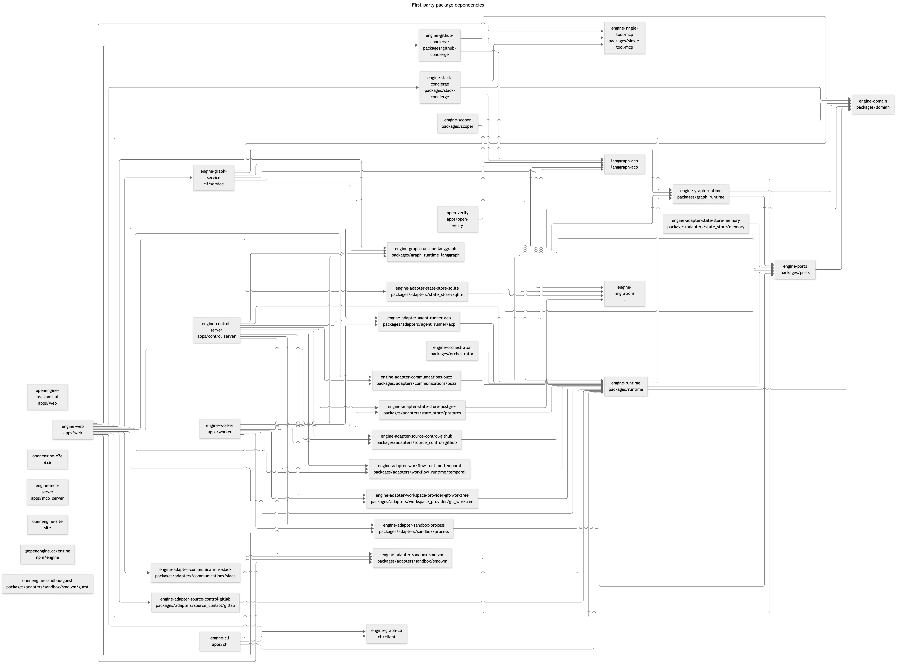

# Package and service architecture



[Mermaid source](packages.mermaid) is generated from the Python
and npm manifests under `packages`, `apps`, `cli`, `langgraph-acp`, `npm`, `site`
and `e2e`, plus the root migration package. Arrows point from a package to its
first-party declared dependency; dashed arrows represent optional dependencies.
External libraries, development dependencies and network calls are omitted.
Environment markers are not evaluated, so the diagram includes all platforms.

## Services and entrypoints

| Service / application | Responsibility and relationships |
| --- | --- |
| Web daemon (`apps/web`) | Serves the React UI and HTTP APIs. Composes concrete adapters, chat/runtime services, graph execution, registered graphs and loops. The CLI and MCP gateway call this service. |
| CLI (`apps/cli`, `cli/client`) | Terminal interface for the daemon and graph APIs. Manages local daemon startup and connects to local or remote backends over HTTP. |
| Graph service (`cli/service`) | Hosted by the web daemon; registers and compiles graphs, schedules loops and exposes run/node steering. Uses the graph runtime and graph database migrations. |
| MCP gateway (`apps/mcp_server`) | Authenticated remote MCP ingress. Forwards work orders to the daemon's HTTP API; it does not embed the execution runtime. |
| Orchestrator (`packages/orchestrator`) | Owns Temporal workflow lifecycle and dispatches work through the runtime. |
| Control server (`apps/control_server`) | Separate composition entrypoint that wires configured capabilities. Currently reports wiring and exits; it does not yet serve ingress. |
| Worker (`apps/worker`) | Separate composition entrypoint for command execution. Currently reports wiring and exits; task-queue polling is not implemented here. |
| Open Verify (`apps/open-verify`) | Independent exploratory QA CLI, using ACP agents through `langgraph-acp`; graph components can invoke it for verification. |

## Shared packages

- `domain` defines shared types; `ports` defines capability interfaces.
- `runtime` dispatches commands through ports and owns agent sessions, approvals
  and tool execution. Composition roots choose the concrete adapters.
- `graph_runtime` defines graph control APIs and contracts;
  `graph_runtime_langgraph` implements them using LangGraph and `langgraph-acp`.
  `langgraph-acp` drives agent sessions over ACP.
- `github-concierge` and `slack-concierge` connect conversations and work orders
  to their respective services. `scoper` determines desired work orders;
  `single-tool-mcp` exposes narrowly scoped tool calls.
- Adapters implement agent execution (ACP), communications (Buzz/Slack), source
  control (GitHub/GitLab), state stores (memory/SQLite/PostgreSQL), workflow
  execution (Temporal), workspaces (Git worktrees) and sandboxes (process/SmolVM).
  Adapter availability does not imply a deployment has configured it.
- The root `engine-migrations` package owns state and graph database migrations.
  LangGraph manages its checkpoint schema separately.
- The npm packages provide the web frontend, distribution launcher, documentation
  site, end-to-end tests and SmolVM guest tooling.

## Keeping the diagram current

The architecture documentation workflow runs on any source change in these package
folders, including additions and deletions. It generates the current dependency
graph, renders PNG when its content changes (or PNG is missing), commits changed
outputs to the source branch, and embeds the PNG with a Mermaid link in open PRs.
Publication is skipped when the generated package graph is unchanged: source edits,
version bumps and external dependency updates do not post another diagram. Package
additions, removals, moves and first-party dependency changes update the graph.
Push runs are limited to main; PR branches run only on pull request events, avoiding
duplicate publication for the same commit. Fork PRs receive downloadable
workflow artifacts because their token cannot write to the source branch.
Publication checks the branch head and never forces updates.

Regenerate locally with Python 3.11+ and Node:

```sh
python scripts/package_diagram.py
npm exec --yes --package=@mermaid-js/mermaid-cli@12.0.0 -- mmdc -i docs/architecture/packages.mermaid -o docs/architecture/packages.png --size 2400 -s 2
```

The generated `package-changes.json` is a temporary publication manifest, not a
source file. This diagram represents the latest packages, without deleted-package
comparison tombstones. See [database architecture](README.md)
for schema diagrams.
