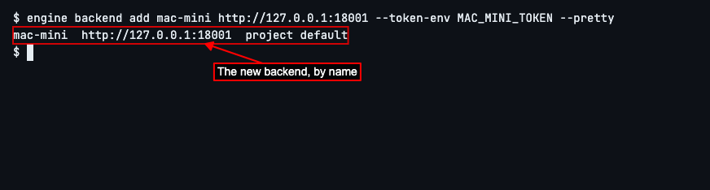
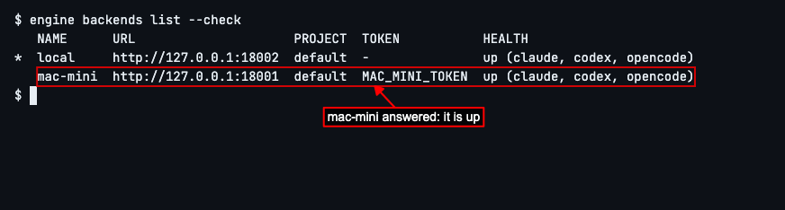
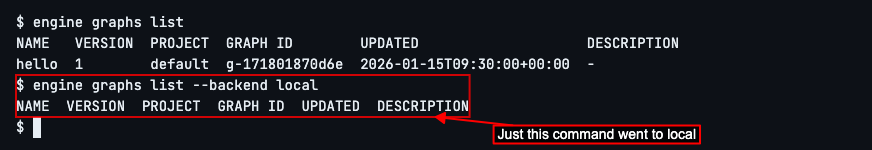

# Connecting to a Backend

## How to connect the CLI to another engine daemon

A backend is a named engine daemon the CLI sends its commands to. `local`, the daemon on your own machine, is there from the start and selected. To add another you need its URL and the `ENGINE_SERVICE_TOKEN` it was started with. Keep the token in an environment variable rather than in commands: `export MAC_MINI_TOKEN=<the token>`.
Run `engine backend add` with a name for the daemon, its URL, and, with `--token-env`, the variable holding its token: `engine backend add mac-mini http://<its host>:4364 --token-env MAC_MINI_TOKEN --pretty`. (`--pretty` prints a line to read rather than JSON for a script; both daemons in this guide run on `127.0.0.1`.)

Run `engine backends list --check` to see every backend, which one is selected (`*`), and whether each one is up. The URLs are your own: `local` is usually `http://127.0.0.1:4364`, but both daemons in this guide run on one machine, each on a port of its own.

Run `engine backend use mac-mini --pretty` to send every command after it to that daemon. `engine backends list` now marks `mac-mini` with `*`.

Commands now go to `mac-mini`. Register a graph there with `engine graph add FILE --pretty`, where `FILE` is any graph file in your project; here it is `hello.yaml`, a graph with one node.
To reach a different backend for one command only, add `--backend NAME` to it. `engine graphs list` lists `hello` on `mac-mini`; `engine graphs list --backend local` lists the graphs on `local`, which has none, and leaves `mac-mini` selected.

`ENGINE_BACKEND=NAME` does the same for every command in a shell or script. `--backend` beats `ENGINE_BACKEND`, which beats the backend chosen with `engine backend use`.

