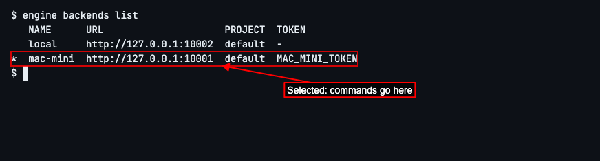
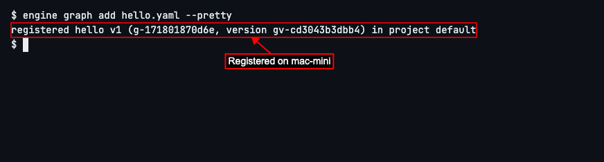
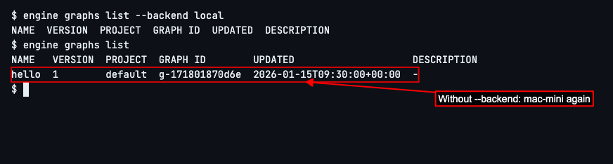

# Connecting to a Backend

## How to connect the CLI to another engine daemon

A backend is a named engine daemon the CLI sends its commands to. `local`, the daemon on your own machine, is there from the start and selected. To add another, you need its URL and the `ENGINE_SERVICE_TOKEN` it was started with. Keep the token in an environment variable rather than typing it into commands: `export MAC_MINI_TOKEN=<the token>`.
Run `engine backend add` with a name for the daemon, its URL, and with `--token-env` the variable holding its token: `engine backend add mac-mini http://<its host>:4364 --token-env MAC_MINI_TOKEN`.
Run `engine backends list --check` to see every backend, which one is selected (`*`), and whether each one is up. (In this guide both daemons run on the same machine, so both URLs point at `127.0.0.1`; yours shows the other machine's host and port 4364.)

Run `engine backend use mac-mini` to send every command after it to that daemon. `engine backends list` now marks `mac-mini` with `*`.

Commands now go to `mac-mini`. Register any graph file from your project there with `engine graph add`; here it is `hello.yaml`, a graph named `hello`. Add `--pretty` for a line of text rather than JSON.

To reach a different backend for one command only, add `--backend NAME` to it. `engine graphs list --backend local` lists the graphs on `local`, which has no `hello`. A plain `engine graphs list` right after it still goes to `mac-mini`, which stays selected.

