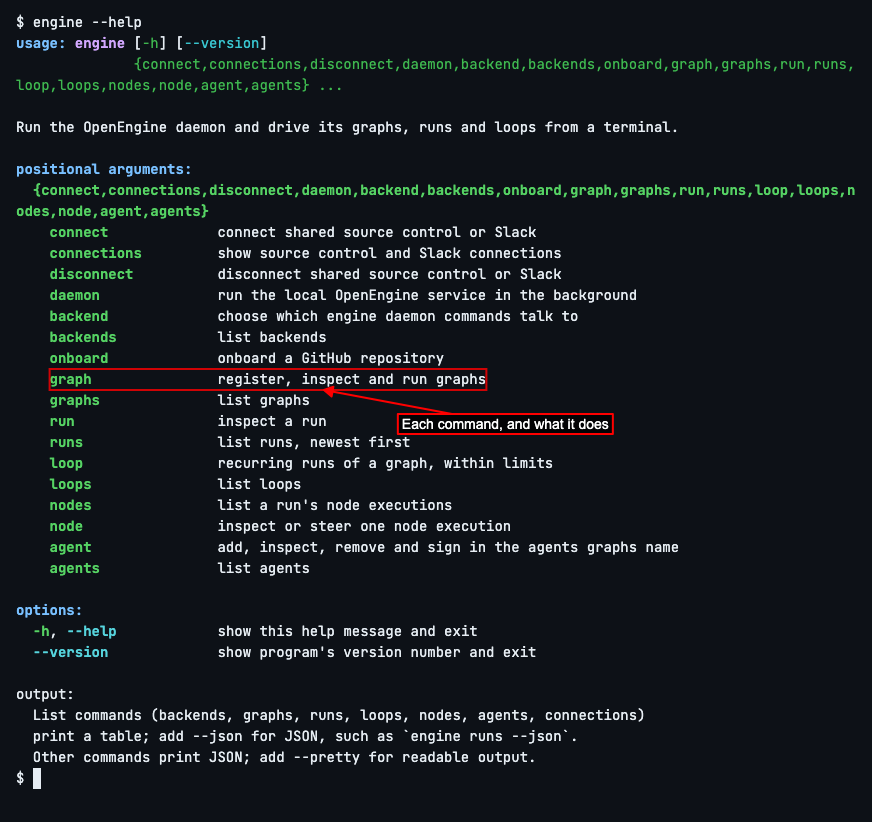
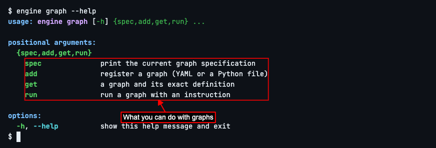

# Getting Help

## How to get help with the engine CLI

Run `engine --help` to see every command and what it does.

Add `--help` to any command to see its own subcommands and options. For example, `engine graph --help`:

