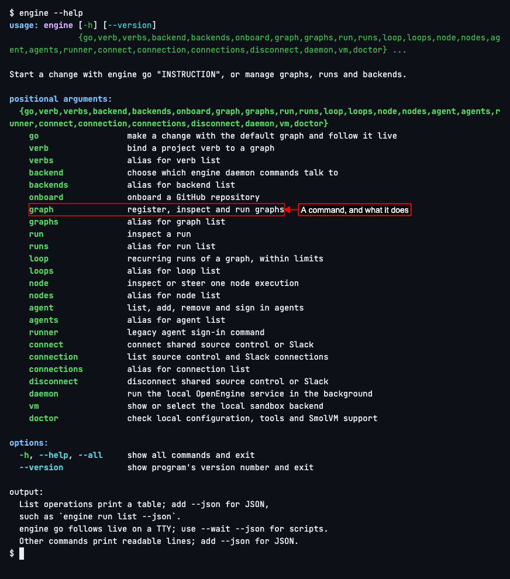
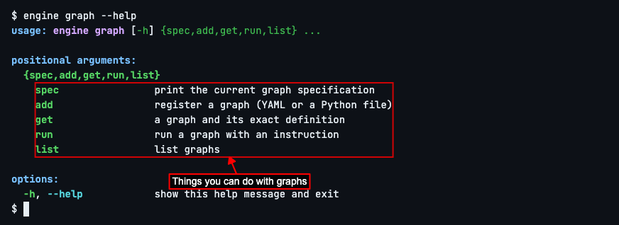

# Getting Help

## See what you can do

Every OpenEngine command starts with `engine`. To see all of them, type `engine --help` and press Enter.

You'll see a list of commands, each with a short note on what it does.

Each command has its own help too: add `--help` after it. For example, `graph` is how you work with graphs, OpenEngine's recipes for a piece of work. Type `engine graph --help` and press Enter.

You'll see the things you can do with graphs.

Whenever you're not sure what to type next, add `--help` to what you have so far.

