# Check On Your Agents and Steer Them

## Check on a run and steer an agent


The `engine` command is what you type in a terminal to use OpenEngine. OpenEngine is a tool that has AI coding agents work on your code, step by step, in the way you lay out. An agent is an AI coding assistant, such as Claude Code, that reads and changes code for you. The way you lay out the work is a **graph**: a recipe for a piece of work, saying its steps, which agent does each one, and in what order. Each time a graph is carried out, from its first step to its last, is called a **run**.

While a run goes on, you may want to know which step it's on and how each agent is getting along. And sometimes an agent sets off in the wrong direction: it misread what you wanted, or you've thought of something it should know. Rather than stopping the run and starting it all over again, you can send that agent a message while it works, and it changes course from where it is. This guide uses the `describe-project` graph from [Run Your Graph and Watch It Work](./test2doc-run-your-graph-and-watch-it-work.mdx).


Start the graph without the live screen. Type `oe graph run describe-project --no-watch` and press Enter.

Your terminal comes straight back, and the run goes on in OpenEngine's background program. You'll see its run ID, starting with `run-`: copy it, because the next commands need it. You can also find it later in the **RUN ID** column of `oe runs list`.

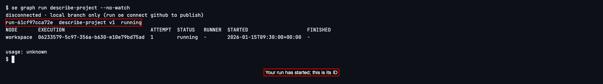

Open the live screen so you can answer an agent's questions and read what it is doing. Type `oe run watch` followed by your run ID, and press Enter.

If you declined repository trust in the previous guide, the read step may be waiting for permission to read README.md. The run waits until you answer; waiting longer won't move it along.

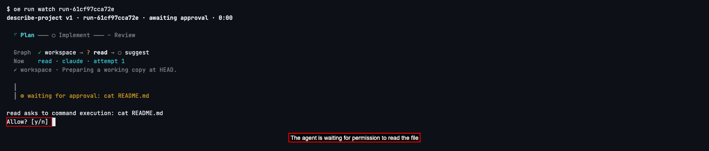

Read the question. Here the agent asks to run `cat README.md`, which reads the file describing your project. Type `y` and press Enter to allow it.

Answer any further permission questions the same way if you want to allow the action. Then watch the lines after ┃: they show the agent's words and actions. Here the suggest agent says it will suggest a new project name. That's the direction we'll correct. Your agent's words may differ, and a short step may finish before you can steer it.

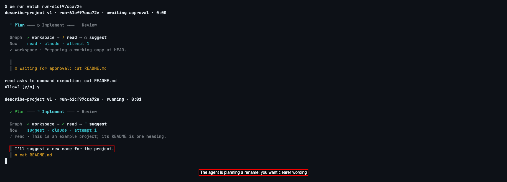

To return to your terminal while the agent keeps working, press Ctrl-C. The screen asks what you want to do.

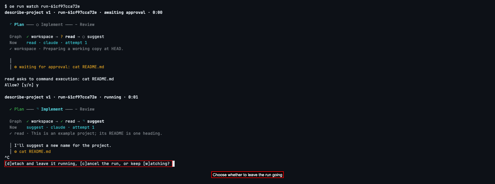

Type `d` and press Enter to detach: close this screen and leave the run going. You can now check individual steps and send your message.

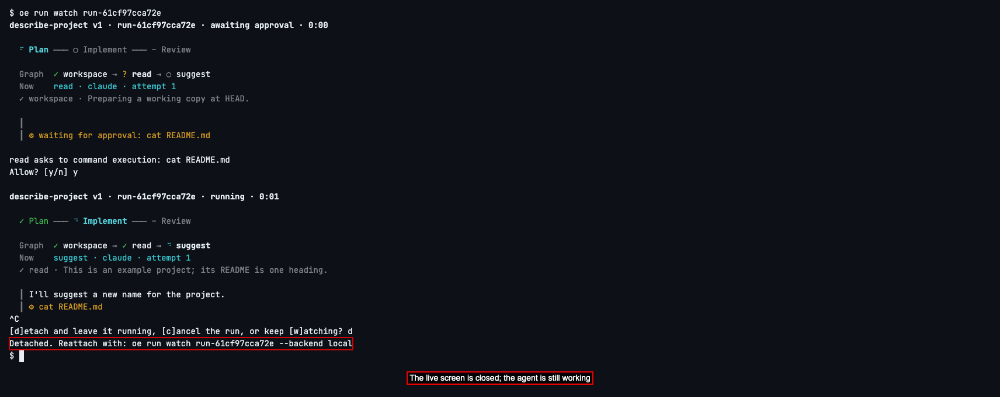

To see which steps are running or finished, type `oe nodes --run` followed by your run ID, and press Enter.

You'll see one row for each step that has started so far. **NODE** is the step's name, **STATUS** says how it's going (*running* while its agent works, *completed* when it's done), and **RUNNER** is the agent doing it. **EXECUTION** is that step's own ID: copy the one for `suggest`, the step that's still running. You can leave the other columns alone.

Here `read` is done and `suggest` is working. If you see only `read`, the run hasn't reached `suggest` yet; wait a moment and run the command again.

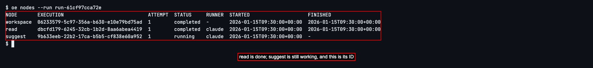

To look at just that one step, type `oe node get` followed by the ID you copied, and press Enter.

You'll see the same row on its own. It's a quick way to check on one agent while it works.

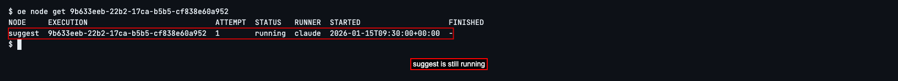

You saw the `suggest` agent propose a new name for your project, and you only wanted its README's wording improved. Tell it so. Type `oe node steer`, the ID you copied, and your message in quotes, then press Enter:

```sh
oe node steer EXECUTION "Keep the project's name. Suggest a clearer first sentence for README.md instead."
```

Put your own step's ID where it says `EXECUTION`. OpenEngine takes your message and passes it to the agent as soon as it can. The reply starts with your message's own ID, then *accepted*: OpenEngine has it, and the agent will get it shortly.

If you see *only a running attempt can be steered*, the step is no longer running. Check its **STATUS** with `oe node get`; you can only redirect an agent while it is working.

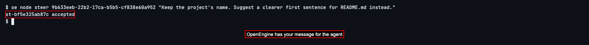

To see whether the agent took your message on board, type `oe node get` and the step's ID again, and press Enter.

Below the step's row there's now a list of the messages you've sent it. **STATUS** goes from *accepted* to *delivered* when the agent has your message, then to *applied* once the agent has finished acting on it. The agent carries on from where it was: the steps already done stay done.

If a message says *undelivered*, it never reached the agent: for example, the step finished before receiving it. If it says *rejected*, OpenEngine no longer has a live connection to that agent for this step. Check the step’s **STATUS** before deciding what to do next; these messages did not change the agent’s course.

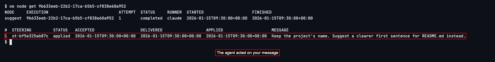

Type `oe runs list` and press Enter.

There's still just the one run, and once `suggest` is done it says *completed*. You changed the agent's course without starting the work over.

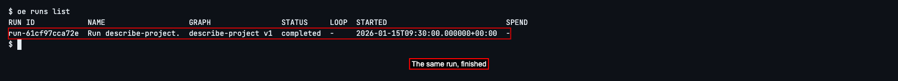

## See which agents you can use


A graph names the agent that does each step, such as `agent: claude`. To see which agents you can name, type `oe agents` and press Enter.

You'll see one row for each agent. **NAME** is what a graph calls it, and **KIND** is the AI coding assistant behind it. The ones marked *built in* are there from the start: `claude` is Claude Code, `codex` is Codex, and `opencode` is OpenCode. The **RUNNER** column of `oe nodes` shows these same names. To use one, its assistant must be installed and signed in on the computer the run happens on.

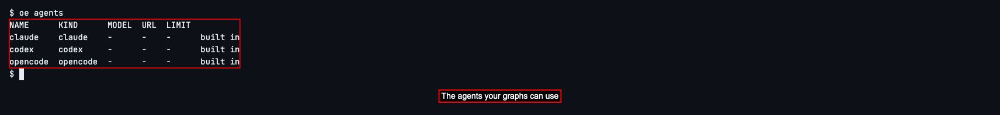

Next, to learn everything else a graph file can say, such as more steps or one agent checking another's work, see [Graphs](../../graphs.md).


