# Run Your Graph and Watch It Work

## Start your graph and watch it


The `oe` command is what you type in a terminal to use OpenEngine. OpenEngine is a tool that has AI coding agents work on your code, step by step, in the way you lay out. An agent is an AI coding assistant, such as Claude Code, that reads and changes code for you. The way you lay out the work is a **graph**: a recipe for a piece of work, saying its steps, which agent does each one, and in what order.

In [Save Your First Graph](./test2doc-save-your-first-graph.mdx) you saved a graph. Now you'll use it. Each time a graph is carried out, from its first step to its last, is called a **run**. While a run goes on, your terminal shows which step it's on and what the agent is saying, so you can see the work happen instead of waiting in the dark. You can also answer an agent that stops to ask you something, walk away and come back, or stop a run you no longer want.


This guide uses a graph with two steps. In your project's folder, save this as `describe-project.yaml`, then type `oe graph add describe-project.yaml` and press Enter to save it to OpenEngine, as in the last guide:

```yaml
apiVersion: openengine.cc/v1
kind: Graph
name: describe-project
plan:
  read:
    agent: claude
    prompt: Read README.md and reply with one sentence saying what this project is. You may use ls to list files and cat to read them. Don't change files.
implementation:
  suggest:
    agent: claude
    prompt: Reply with one sentence suggesting one small improvement to README.md. Don't run commands or change files.
```

`plan` and `implementation` are two of a graph's **stages**: groups of steps that happen one after another. The first stage plans the work and the second does it. Here each has one step: `read` looks at your README, then `suggest` proposes an improvement to it.

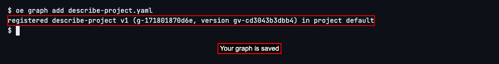

Start the graph. Type `oe graph run describe-project` and press Enter.

The first time you run a graph in a folder, OpenEngine asks whether to trust it. Trusting a folder lets agents change files and run commands there without asking you first. Type `n` and press Enter: the agents will check with you before they run a command. You can change that choice later.


If an agent asks to run a command, read the question. Type y and press Enter to allow it. Here the agent reads README.md, the file that describes your project.

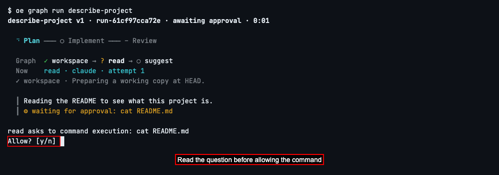

Now watch. The screen redraws itself as the run goes on:

- The top line is the graph's name and version, the run ID, how it's going, and how long it has taken.
- The next line is the stages. A spinning mark is the stage in progress, ✓ is one that's done, and ○ is one still to come. – means this graph has nothing in that stage.
- *Graph* lists every step in order, with the same marks, and *Now* says which step is running and which agent is doing it.
- At the bottom, after ┃, is what the agent is saying and doing right now.

If you see *cannot reach backend*, OpenEngine's background program isn't running. A **backend** is a computer where that program runs: this one, or a remote machine. Follow the [instructions to start OpenEngine](../../cli-reference.md#engine-daemon-start), then start the graph again.

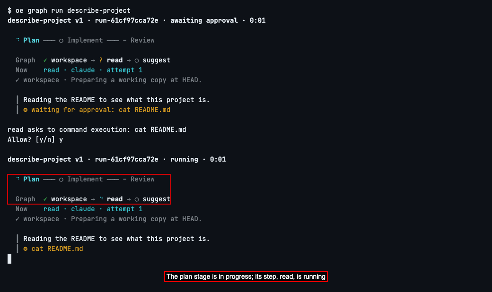

Keep watching until the run ends. When the last step is done, every mark turns to ✓, the top line says *completed*, and below it you'll see what the last step's agent replied.

If an agent asks to run a command, read the question. To allow it, type `y` and press Enter. Answer any further questions the same way when you want to allow the requested action. Once the work is done, the run ends on its own.

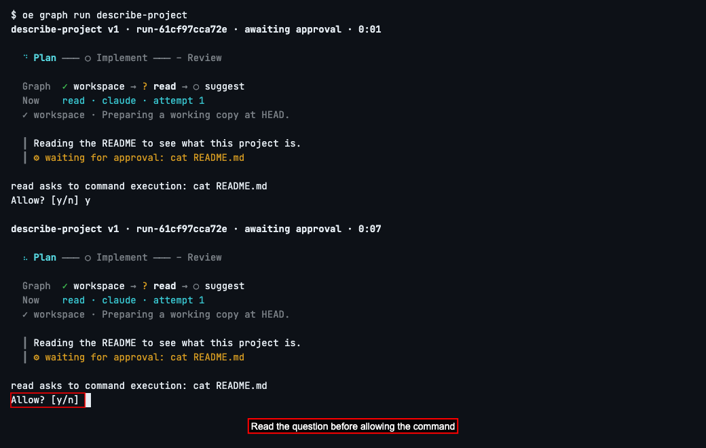
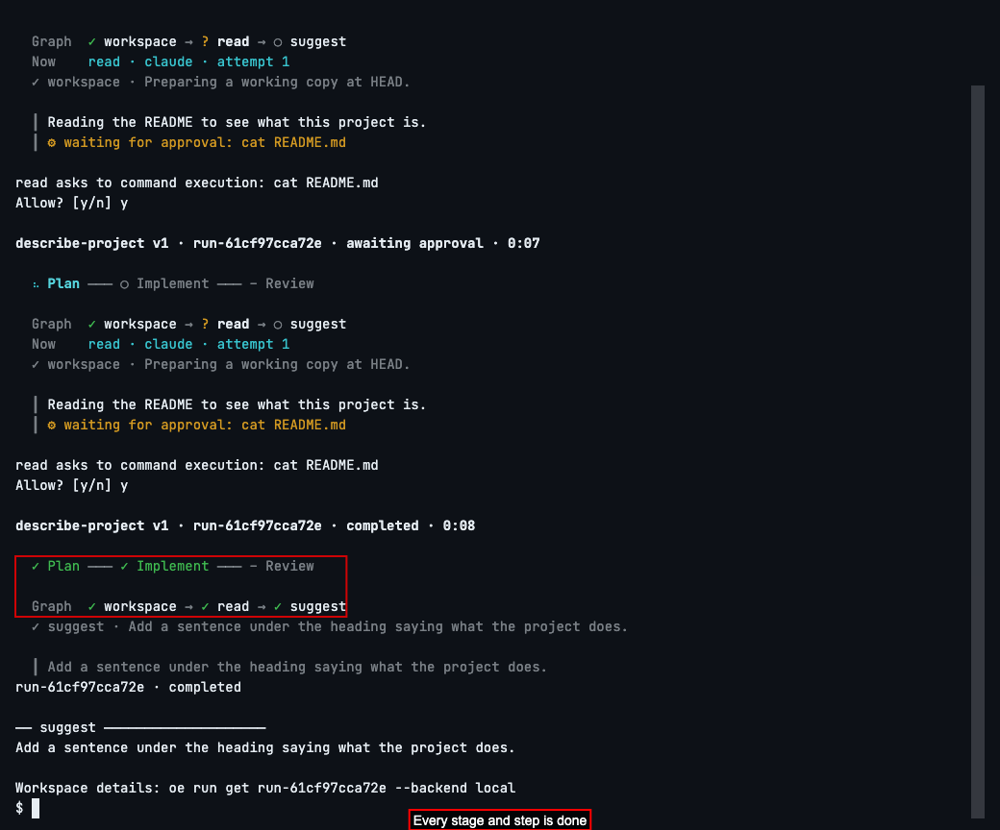

To see your runs afterwards, type `oe runs list` and press Enter.

You'll see one row for each run, newest first, with the graph it ran and its status: *completed* when it finished, *cancelled* if you stopped it, and *running* if it's still going. You can leave the other columns alone.

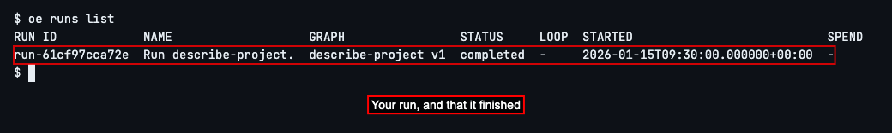

## Answer an agent's question


Sometimes an agent stops and asks you something, such as whether it may run a command. The run waits for your answer, and the question appears right in the screen you're watching.

Start the graph again with `oe graph run describe-project`, and answer `n` if you're asked whether to trust the folder.


When an agent asks, the screen stops redrawing and shows the question: which step is asking, and what it wants to do. Here the `read` step asks to run `ls`, a command that lists the files in a folder. The question mark in the *Graph* line shows the step waiting for you.

Type `y` and press Enter to let it, or `n` to say no. If you say no, the command is not run and this run ends as failed. Start the graph again if you want to try again.

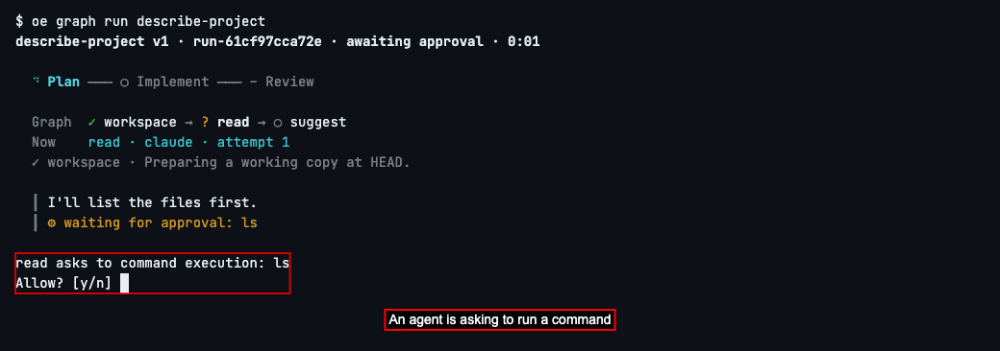

The run picks up where it was and goes on to the end, as before.

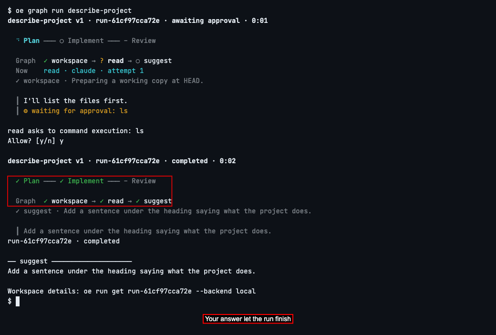

## Step away and come back


A run doesn't need your terminal open. It goes on in OpenEngine's background program, so you can close the screen that shows it, do something else, and come back to it later, for example when an agent has a question for you.

Start the graph with `oe graph run describe-project`, and answer `n` if you're asked whether to trust the folder.

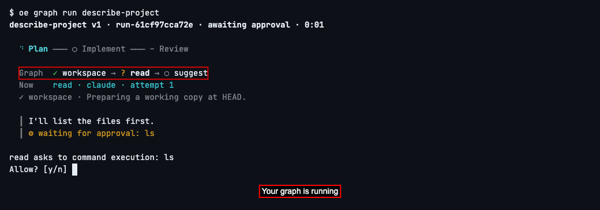

To step away, press Ctrl-C: hold down the Control key and press C.

The screen stops and asks what you want: *d* to detach, which closes this screen and leaves the run going; *c* to cancel the run; or *w* to keep watching.

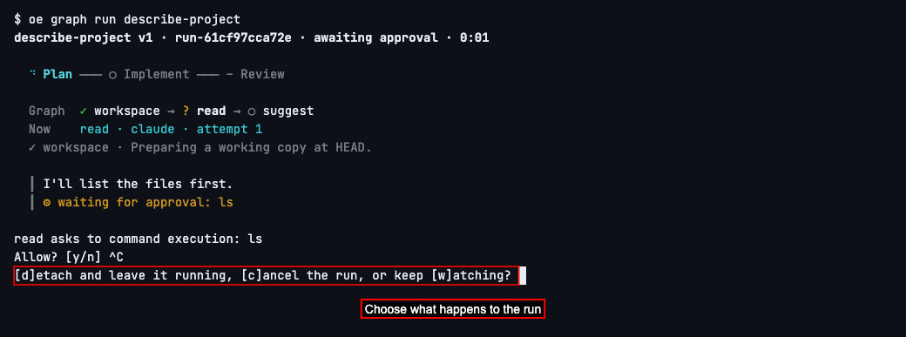

Type `d` and press Enter.

The screen says *Detached* and gives you the command to come back with, which includes the run ID. `local` means the backend on this computer; it's there from the start. Copy it somewhere, or find the ID later in the **RUN ID** column of `oe runs list`. The run is still going, waiting for the answer to its question.

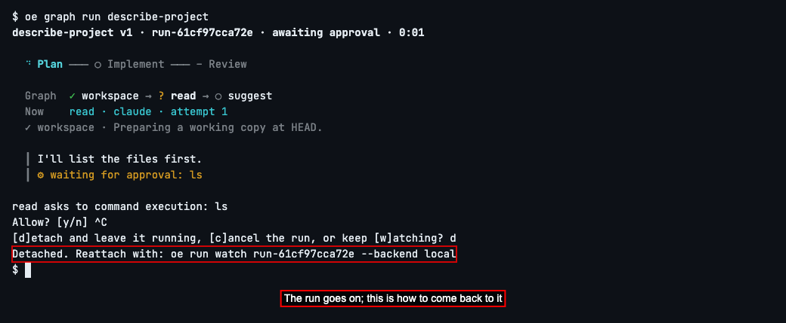

To come back, type the command it gave you, `oe run watch` followed by the run ID, and press Enter.

The same screen comes back, showing where the run is now. Since the agent is still waiting, its question is asked again.

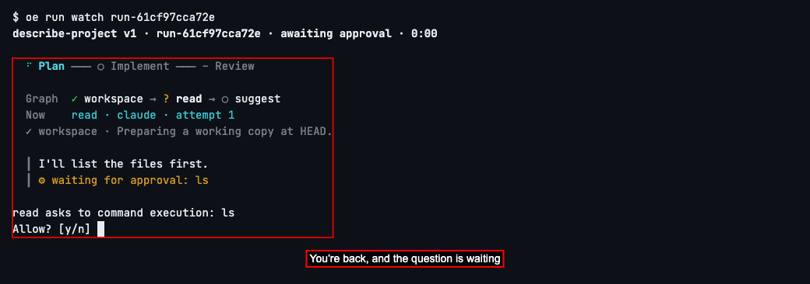

Type `y` and press Enter, and the run goes on to the end.

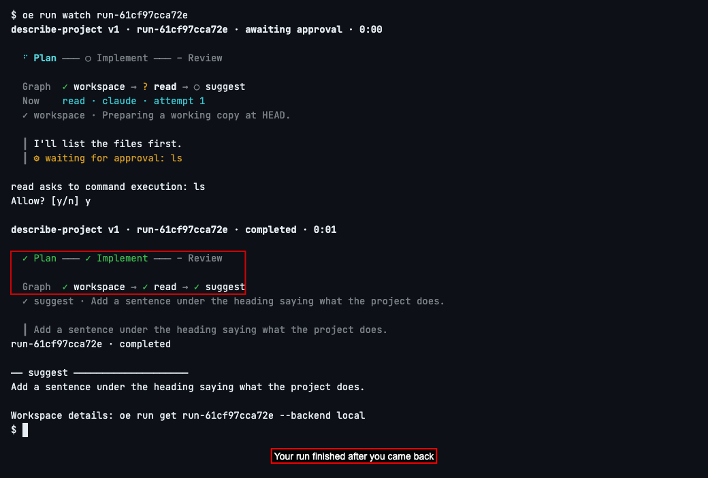

## Stop a run


If you started the wrong graph, or no longer need what it's doing, you can stop it. Start the graph with `oe graph run describe-project`, and answer `n` if you're asked whether to trust the folder.

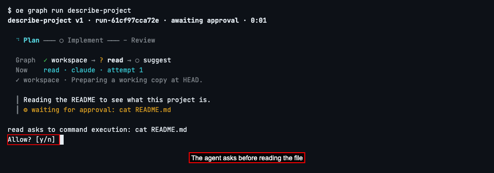

Read the question. Type y and press Enter to let the agent read README.md before you stop its work.

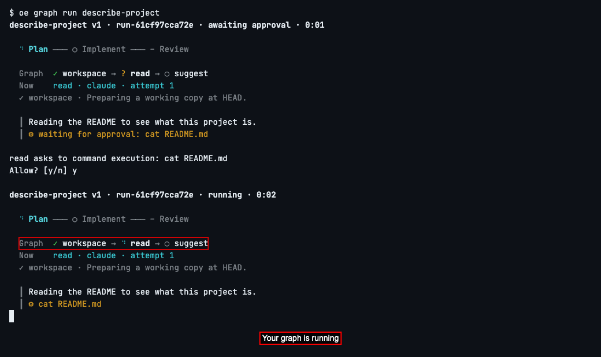

While it's running, press Ctrl-C. When the screen asks what you want, type `c` and press Enter.

OpenEngine stops the agent and ends the run. Below the last view of its progress, a summary shows the run ID and *cancelled*.

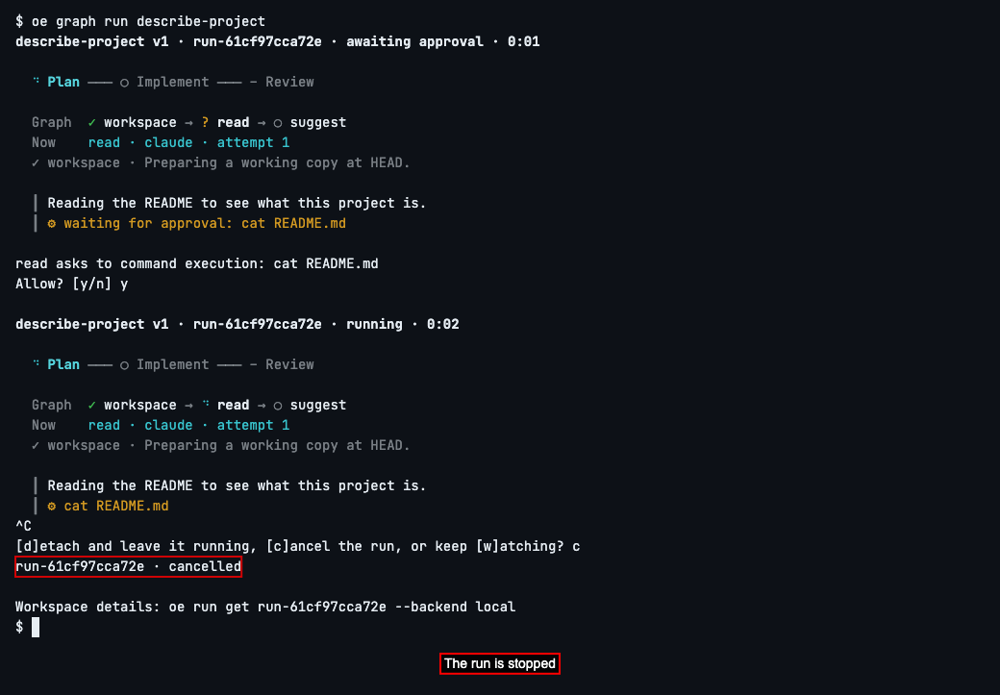

Type `oe runs list` and press Enter. Your run is there with the status *cancelled*. A cancelled run can't be picked up again; to do the work after all, start the graph again.

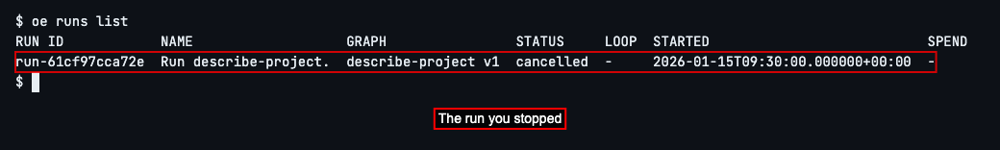

Next, to learn everything else a graph file can say, such as more steps or one agent checking another's work, see [Graphs](../../graphs.md).


