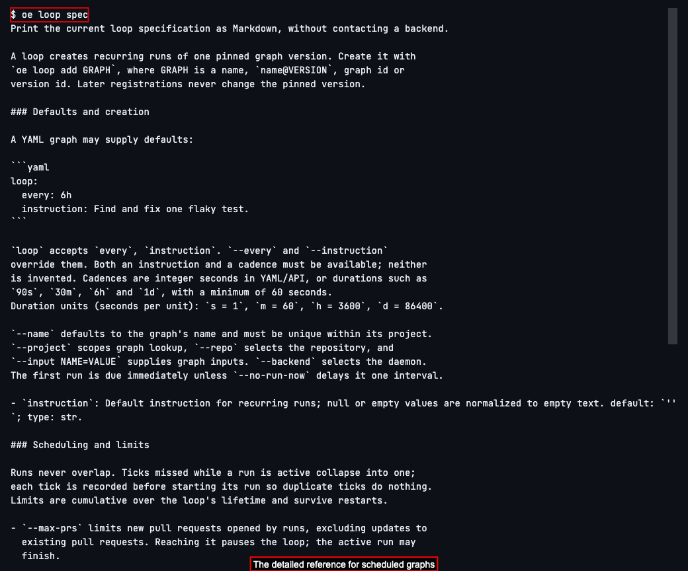
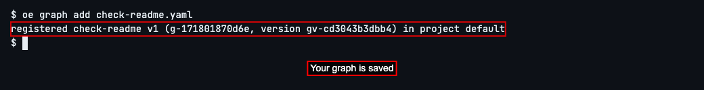
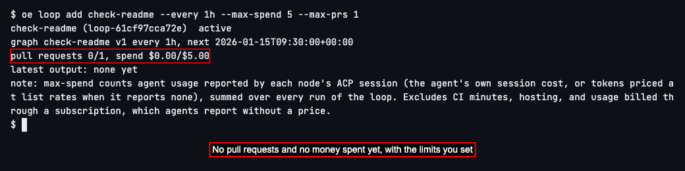
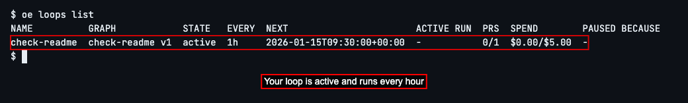
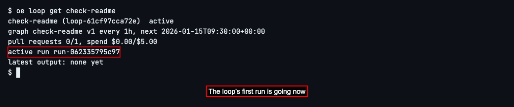
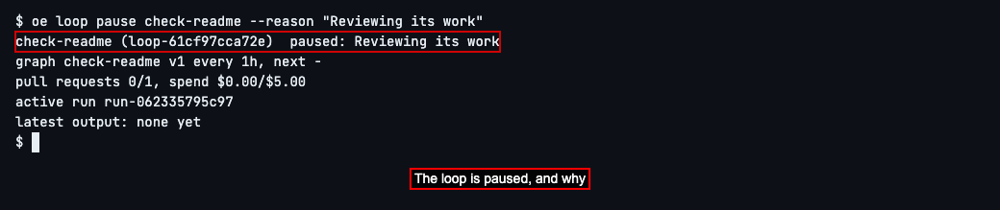
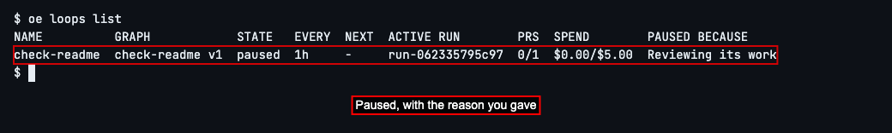
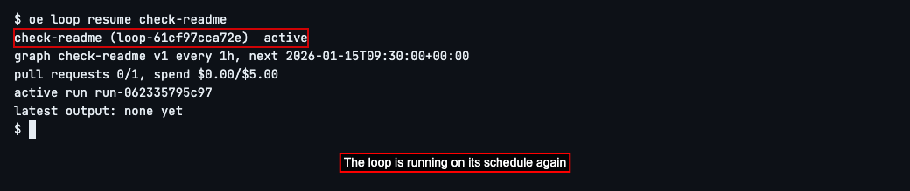
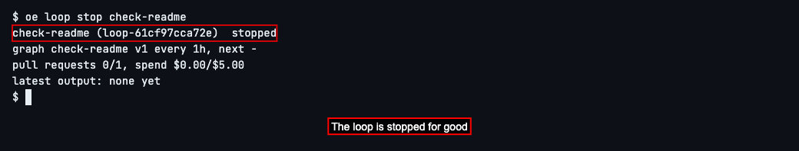
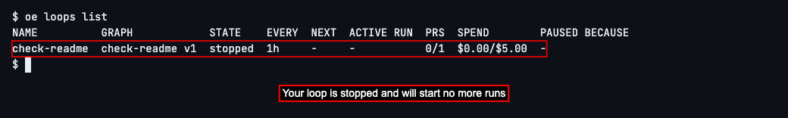

# Run Your Graph on a Schedule

## Set up a loop and check on it

Read about scheduled graphs

The `oe` command is what you type in a terminal to use OpenEngine. OpenEngine is a tool that has AI coding agents work on your code, step by step, in the way you lay out. An agent is an AI coding assistant, such as Claude Code, that reads and changes code for you. The way you lay out the work is a **graph**: a recipe for a piece of work, saying its steps, which agent does each one, and in what order. Each time a graph is carried out, from its first step to its last, is called a **run**.

Some work is never finished for good: keeping a README up to date, fixing one flaky test at a time, tidying a little more each day. Instead of starting the same graph yourself every few hours, you can set up a **loop**: a graph set to run again and again on a schedule, with limits on how much it may spend. You choose how often it runs, how much money its agents may spend in all, and how many pull requests (proposed changes to your code) it may open. When it reaches a limit, it pauses itself, and you can pause or stop it yourself at any time.


To read everything a loop can do, type `oe loop spec` and press Enter.

You'll see detailed reference material about loops: how to set one up, how often it can run, its limits, and how to pause it. You don't need any of it to follow this guide, but it's there whenever you want the details.



A loop needs a graph to run. This guide uses one with a single step. In your project's folder, save this as `check-readme.yaml`, then type `oe graph add check-readme.yaml` and press Enter to save it to OpenEngine, as in [Save Your First Graph](./test2doc-save-your-first-graph.mdx):

```yaml
apiVersion: openengine.cc/v1
kind: Graph
name: check-readme
loop:
  every: 1h
  instruction: Look at README.md and suggest one small improvement.
implementation:
  suggest:
    agent: claude
    prompt: Reply with one sentence suggesting one small improvement to README.md. Don't run commands or change files.
```

The `loop` part is new. `every: 1h` says to run the graph once an hour, and `instruction` is what to ask for on each run. You can use `30m` for half an hour or `1d` for once a day; a loop can't run more often than once a minute.



Set up the loop. Type `oe loop add check-readme --every 1h --max-spend 5 --max-prs 1` and press Enter.

`--max-spend 5` sets a $5 limit on reported agent usage across every run. OpenEngine stops the active run when reported spending reaches the limit; usage it cannot price and other costs, such as hosting, are not included. `--max-prs 1` means it may open at most one pull request. When the loop reaches either limit, it pauses itself. `--every 1h` says how often to run; you can leave it out when the graph says, as this one does.

OpenEngine shows the loop's name, that it's *active*, how often it runs and when it runs next, and what it has used so far of each limit. Its first run starts right away. If OpenEngine asks whether to trust the folder, answer `n`, as in the last guide.



To see all your loops, type `oe loops list` and press Enter.

You'll see one row for each loop, with its graph, its state (*active*, *paused* or *stopped*), how often it runs, when it runs next, and how far it is toward each limit: *PRS* is pull requests opened out of the most allowed, and *SPEND* is money spent out of the most allowed.



To look at one loop more closely, type `oe loop get check-readme` and press Enter.

Along with what the list shows, you'll see the run it's doing now, if there is one, under *active run*. Once a run has finished, *latest output* shows what its last step replied. To follow the run as it goes, type `oe run watch` and the run ID, as in [Run Your Graph and Watch It Work](./test2doc-run-your-graph-and-watch-it-work.mdx).



## Pause a loop and start it again


If you want a loop to take a break, for example while you review what it has done so far, pause it. A paused loop starts no new runs until you start it again. A run that's already going carries on to its end.

Type `oe loop pause check-readme --reason "Reviewing its work"` and press Enter. The reason is for you and anyone else who looks at the loop later; you can leave it out.



Type `oe loops list` and press Enter. Your loop shows *paused*, with your reason under *PAUSED BECAUSE*. When a loop pauses itself because it reached a limit, this is where it says which one.



To start it again, type `oe loop resume check-readme` and press Enter. The loop is *active* again and goes back to its schedule.

If it paused itself because it reached a limit, it won't start again until you raise that limit: add a higher one, such as `--max-spend 10` or `--max-prs 2`, to the same command.



## Stop a loop for good


When you no longer want a loop at all, stop it. Unlike pausing, stopping is for good: the loop starts no more runs, the run it's doing now is stopped too, and it can't be started again. To have the graph run on a schedule again later, set up a new loop with a different name using `--name`.

Type `oe loop stop check-readme` and press Enter. OpenEngine shows the loop as *stopped*.



Type `oe loops list` and press Enter. Your loop is still listed, as *stopped*, so you can look back at what it did. Its last run shows as *cancelled* in `oe runs list`.

Next, to learn everything else a graph file can say, such as more steps or one agent checking another's work, see [Graphs](../../graphs.md).



