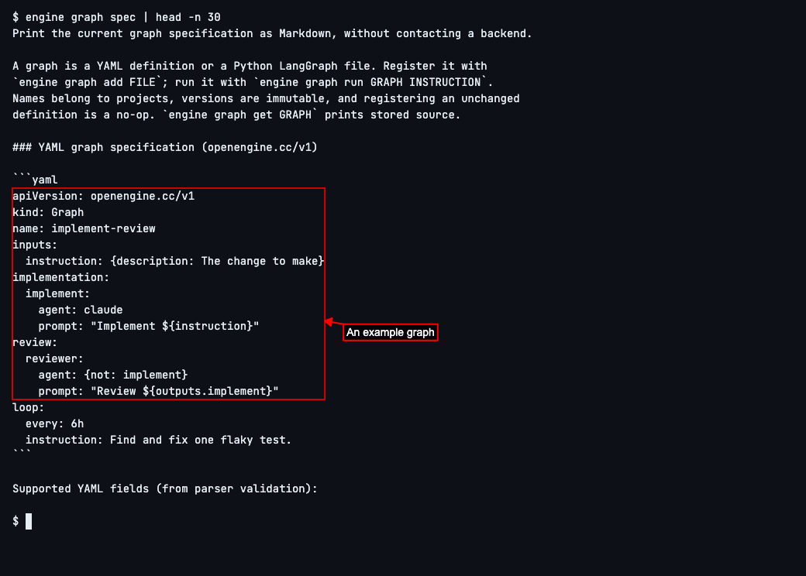
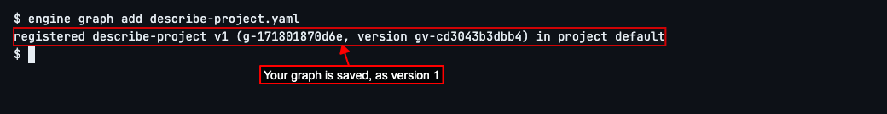
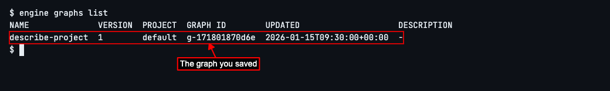
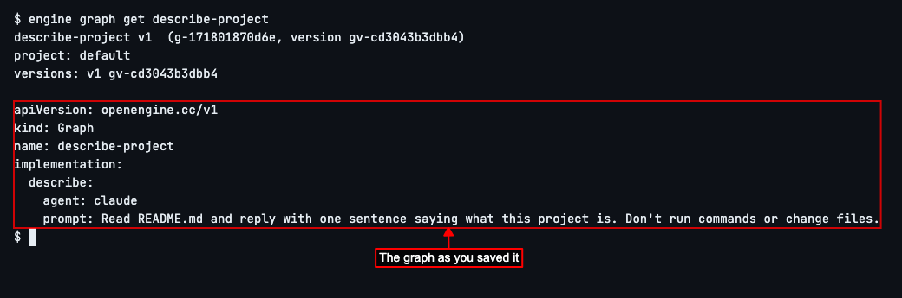
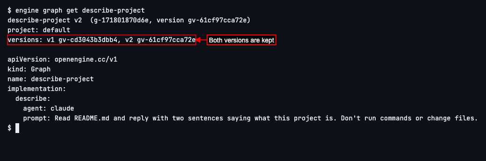
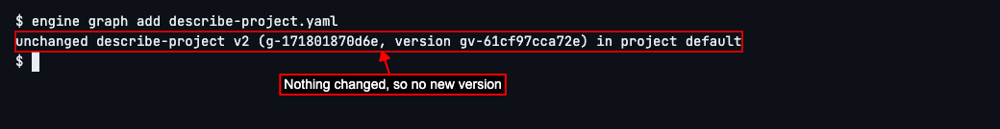

# Save Your First Graph

## Write a graph, save it, and change it


OpenEngine is a tool that has AI coding agents work on your code, step by step, in the way you lay out. An agent is an AI coding assistant, such as Claude Code, that reads and changes code for you.

The way you lay out the work is a **graph**: a recipe for a piece of work, saying its steps, which agent does each one, and in what order. You write it once in a small text file and save it to OpenEngine, so you can find it and use it again whenever you need that piece of work done, instead of explaining it from scratch each time.

This guide shows how to write a graph, save it, find it again, and what happens when you change it. Running a graph comes in the next guide.


Every graph file follows the same layout. To see it, with an example, type `engine graph spec | head -n 30` and press Enter. `engine graph spec` describes everything a graph file can say, which is long; `| head -n 30` shows only its first 30 lines, where the example is.

You'll see a short example graph. It has more in it than a first graph needs: the next step shows the few lines yours needs. This works even when OpenEngine isn't running, so you can write a graph anywhere.



Write your graph. In your project's folder, make a file called `describe-project.yaml` with any text editor, and copy this into it:

```yaml
apiVersion: openengine.cc/v1
kind: Graph
name: describe-project
implementation:
  describe:
    agent: claude
    prompt: Read README.md and reply with one sentence saying what this project is. Don't run commands or change files.
```

The first two lines say this is an OpenEngine graph. `name` is what you'll call it later. Under `implementation` is its one step, `describe`: the agent that does it, here Claude Code, and the `prompt`, which is what you ask that agent to do, in plain words.

Keep the spaces at the start of each line as they are: they show which lines belong to which.


Save the graph to OpenEngine. Type `engine graph add describe-project.yaml` and press Enter.

The screen says *registered*, OpenEngine's word for saved, then the graph's name and `v1`: this is its first version. The labels in brackets are how OpenEngine tells graphs and their versions apart; you can leave them alone.

If you see *cannot reach backend*, OpenEngine isn't running on this computer: start it and try again. If OpenEngine finds a mistake in the file, it lists what's wrong and where in the file; fix it and run the command again.



Later, to find the graphs you've saved, type `engine graphs list` and press Enter.

You'll see one row for each graph, with its name and latest version. You can leave the other columns alone.



To see what a saved graph says, type `engine graph get describe-project` and press Enter.

You'll see the graph's name and version, the versions OpenEngine has of it, and then the file exactly as you saved it.



Now change the graph. In `describe-project.yaml`, change *one sentence* in the prompt to *two sentences*, and save the file. Then type `engine graph add describe-project.yaml` and press Enter again.

This time the screen says `v2`: OpenEngine saved your change as a new version. It keeps the old one too, so a change never overwrites what you had.


Type `engine graph get describe-project` and press Enter.

The line starting *versions* lists both versions, and below it is the file as it is now, with *two sentences*. When you use a graph by its name, OpenEngine uses its latest version.



If you save a graph again without changing it, nothing new is made. Type `engine graph add describe-project.yaml` and press Enter once more, without touching the file.

The screen says *unchanged* and `v2`: OpenEngine already has this exact graph, so it keeps the version it had. You can save as often as you like; only a real change makes a new version.



Next, to learn everything else a graph file can say, such as more steps or one agent checking another's work, see [Graphs](../../graphs.md).


