# Protect Your OpenEngine with a Token

## Protect the other computer and recover from a missing or wrong token

Anyone who can reach your OpenEngine address could otherwise use it. A **token** is a secret password that OpenEngine asks for before doing work. Give the OpenEngine on your other computer a token so only people with that token can use it.

Once it has a token, OpenEngine asks for it everywhere, even in a browser on the other computer itself. In a browser, you sign in once with the token. In a terminal, the `oe` command sends the token for you. If you never set a token, OpenEngine stays open to programs on its own computer, as before.

OpenEngine is a tool that has AI coding agents work on your code, step by step, in the way you lay out. A **backend** is a computer where OpenEngine's background program is running: this one, or another one such as a Mac mini. The `oe` command is what you type in a terminal to use OpenEngine.

You'll need OpenEngine installed on both computers and a private network or tunnel that lets this computer reach the other one. Here its address is `https://mac-mini.local:4364`; replace it with yours. Keep using that protected connection: a token does not encrypt the connection. To reach the other computer from outside your home network, see [Reach Your OpenEngine From Anywhere](./test2doc-reach-your-openengine-from-anywhere.mdx). Keep your token private and choose your own unique value instead of the example below. It must be at least 32 characters long, with no spaces; OpenEngine won't start with a shorter one. Start in a terminal on the other computer.

On the other computer, type `export ENGINE_SERVICE_TOKEN='example-only-8a71f204d6c539be072a19f5e4c083bd'` and press Enter.

This stores the token in that terminal for OpenEngine to read when it starts. It lasts until you close the terminal. If OpenEngine is already running, stop it first with Ctrl+C in its terminal.

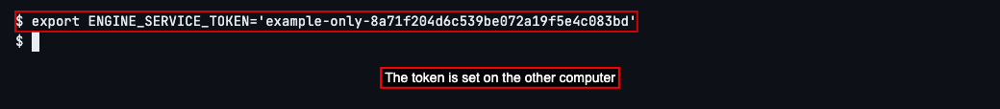

In that same terminal on the other computer, type `engine-web` and press Enter.

Leave this terminal open. OpenEngine starts with the token you set. If you start it again later, set the same token first. If someone manages its startup for you, ask them to put `ENGINE_SERVICE_TOKEN` in its startup environment and restart it.

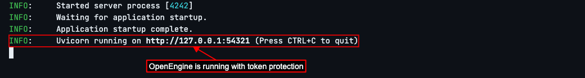

To use OpenEngine in a browser now, open its address, `https://mac-mini.local:4364`. Use that address on the other computer too: if you gave OpenEngine a public address in [Reach Your OpenEngine From Anywhere](./test2doc-reach-your-openengine-from-anywhere.mdx), it refuses sign-in from `http://127.0.0.1:4364`. Only without a public address can you sign in at `http://127.0.0.1:4364` on the other computer itself. Instead of your work, you see a sign-in form. Paste the token you set and choose sign in.

The browser remembers that you signed in, even after you close it. Choose Sign out when you finish on a computer other people use. If you change the token later, every browser has to sign in again.

To use the other computer from a terminal on this one, type `export MAC_MINI_TOKEN='example-only-8a71f204d6c539be072a19f5e4c083bd'` and press Enter.

Copy the same secret value you set on the other computer. `MAC_MINI_TOKEN` is a name for storing it in this terminal; you can choose another name. Set it again whenever you open a new terminal. Don't paste the token into a shared document or commit it with your code.

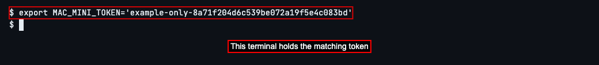

Type `oe backend add mac-mini https://mac-mini.local:4364 --token-env MAC_MINI_TOKEN` and press Enter.

Use the variable's name after `--token-env`, not the secret value. OpenEngine saves the name and reads its value whenever you send a command.

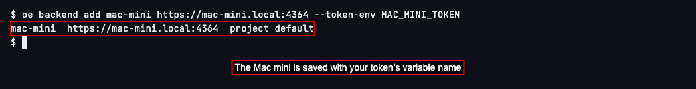

If you already added the Mac mini by following [Use OpenEngine on Another Computer](../test2doc-other-computers/test2doc-use-openengine-on-another-computer.mdx), OpenEngine doesn't save it again. Instead, it says the Mac mini already exists, like this.

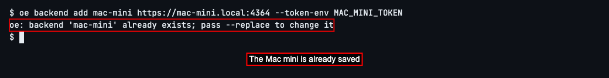

In that case, type `oe backend add mac-mini https://mac-mini.local:4364 --token-env MAC_MINI_TOKEN --replace` and press Enter.

`--replace` updates the Mac mini you saved before, so it now uses your token's variable name. OpenEngine shows what it saved, as above.

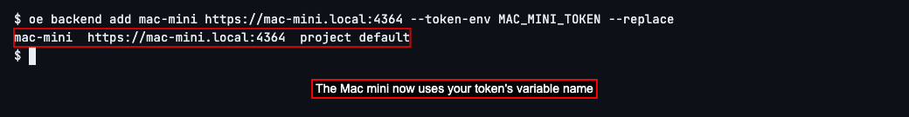

Type `oe graphs list --backend mac-mini` and press Enter.

The Mac mini answers with its list of graphs. A graph is a recipe for a piece of work: its steps, which agent does each one, and in what order. An agent is an AI coding assistant, such as Claude Code, that reads and changes code for you. An empty list is fine too: the token let you in.

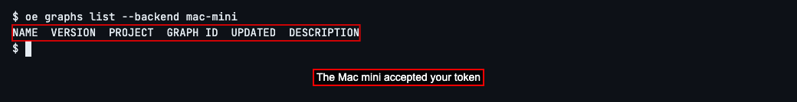

To see what happens in a terminal without the token, type `unset MAC_MINI_TOKEN` and press Enter.

This removes the token from this terminal. The other computer stays protected.

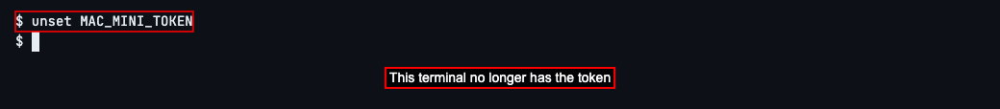

Type `oe graphs list --backend mac-mini` and press Enter.

OpenEngine refuses the request and says the Mac mini requires a token. If you see this in a new terminal, store the matching token there again as shown next.

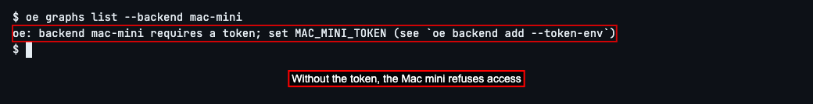

Type `export MAC_MINI_TOKEN='example-only-8a71f204d6c539be072a19f5e4c083bd'` and press Enter to restore the matching token.

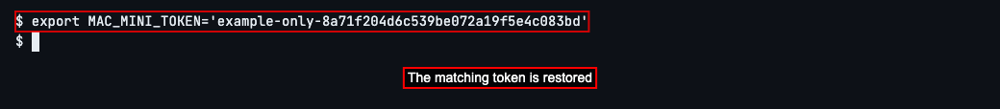

Type `oe graphs list --backend mac-mini` and press Enter.

The list appears again: you have access.

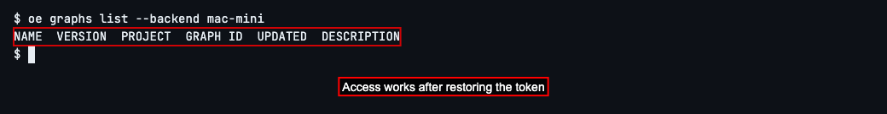

To see what a mistyped token does, type `export MAC_MINI_TOKEN='wrong-example-token'` and press Enter.

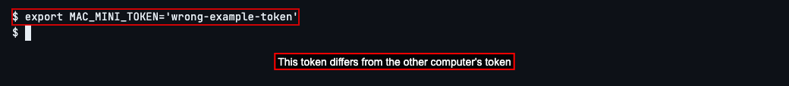

Type `oe graphs list --backend mac-mini` and press Enter.

OpenEngine refuses this token too. The same token message can mean either a missing token or one that doesn't match. Copy the value from the other computer carefully; keep the variable name you saved with `--token-env`.

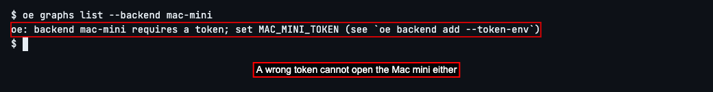

Type `export MAC_MINI_TOKEN='example-only-8a71f204d6c539be072a19f5e4c083bd'` and press Enter to replace the wrong value with the matching token.

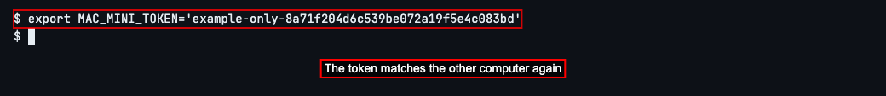

Type `oe graphs list --backend mac-mini` and press Enter.

The list appears again. Keep using this terminal, or set the token in each new terminal before sending work to the Mac mini.

Next, choose which computer your commands go to: see [Use OpenEngine on Another Computer](../test2doc-other-computers/test2doc-use-openengine-on-another-computer.mdx).

