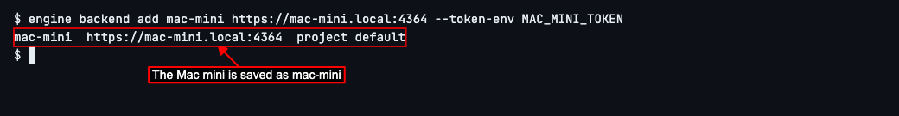
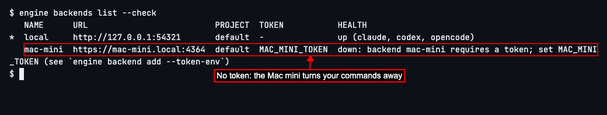
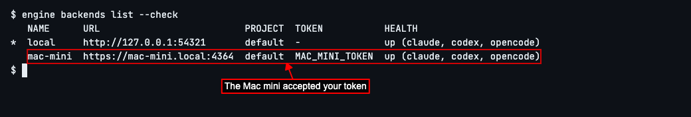
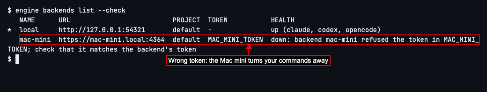
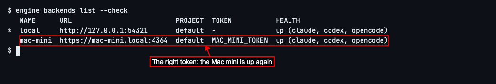

# Protect Your OpenEngine with a Token

## Set a token on the Mac mini and use it from this computer


OpenEngine is a tool that has AI coding agents work on your code, step by step, in the way you lay out. When it runs on another computer, such as a Mac mini, anyone who can reach that computer's address could use it: start agents on your code, or change what it's set up to do. A **token** stops that. It's a long secret, like a password, that you set on the other computer. OpenEngine there then only answers commands that come with it.

This guide shows how to set a token on the Mac mini, give it to the `engine` command on this computer, and what you'll see if the token is missing or wrong. Each computer OpenEngine runs on is called a **backend**. You'll need OpenEngine already running on the Mac mini, and an address that reaches it from here: in this example, `https://mac-mini.local:4364`. [Use OpenEngine on Another Computer](test2doc-use-openengine-on-another-computer.mdx) shows how to set that up.


On the Mac mini, make a token. In a terminal there, type `openssl rand -hex 32` and press Enter.

You'll see a long line of letters and numbers. That's your token. Keep it secret: anyone who has it can use OpenEngine on the Mac mini.


Still on the Mac mini, give the token to OpenEngine. Open the file `~/.config/openengine/.env` in a text editor, creating it if it isn't there, and add this line, with your token after the `=`:

```text
ENGINE_SERVICE_TOKEN=your-token
```

Save the file. Then restart OpenEngine there so it reads the token: type `engine daemon stop`, press Enter, then type `engine daemon start` and press Enter. From now on, OpenEngine on the Mac mini answers only commands that come with this token. If you open its web page in a browser, enter the same token on the sign-in screen.


Back on this computer, tell OpenEngine about the Mac mini, and the name of the place where you'll keep its token. Type `engine backend add mac-mini https://mac-mini.local:4364 --token-env MAC_MINI_TOKEN` and press Enter.

OpenEngine saves the Mac mini under the name `mac-mini`, and remembers `MAC_MINI_TOKEN`: the name of a setting in your terminal, called an environment variable, that `engine` reads the token from each time it talks to the Mac mini. The token itself is never saved in OpenEngine's list of computers.

If you already added the Mac mini without a token, run the same command: it saves the Mac mini again, this time with `MAC_MINI_TOKEN`.



Before giving this computer the token, see what happens without it. Type `engine backends list --check` and press Enter.

Beside the Mac mini you'll see *down*, and that it *requires a token*: OpenEngine reached it, but the Mac mini turned the command away because no token came with it. It names `MAC_MINI_TOKEN`, the place it looked for one. If you ever see this, give this computer the token, as in the next step.



Give this computer the token. Type `export MAC_MINI_TOKEN=`, paste the token you made on the Mac mini straight after the `=`, and press Enter.

Nothing appears; that's expected. This keeps the token for this terminal window only. To keep it for every new window, add the same line to the file `~/.zshrc` on this computer, then open a new terminal window.


Type `engine backends list --check` and press Enter again.

This time you'll see *up* beside the Mac mini: it accepted the token, and your commands can use it.



A token that doesn't match the one on the Mac mini is turned away too: say you made a new token there and this computer still has the old one. To see what that looks like, type `export MAC_MINI_TOKEN=` followed by an old or mistyped token, press Enter, and then type `engine backends list --check` and press Enter.

Beside the Mac mini you'll see *down*, and that it *refused the token in MAC_MINI_TOKEN*: a token came with the command, but not the one the Mac mini has.



To fix it, copy the token from the Mac mini again: it's the line starting `ENGINE_SERVICE_TOKEN=` in `~/.config/openengine/.env` there. On this computer, type `export MAC_MINI_TOKEN=`, paste it straight after the `=`, and press Enter. If you also added it to `~/.zshrc`, change it there too.

Then type `engine backends list --check` and press Enter. You'll see *up* beside the Mac mini again.



Next, switch your commands to the Mac mini and save a graph there: see [Use OpenEngine on Another Computer](test2doc-use-openengine-on-another-computer.mdx).


