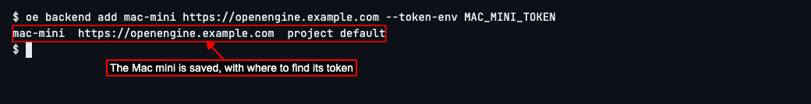
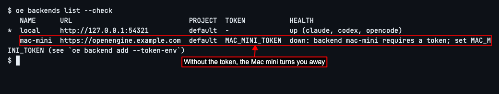
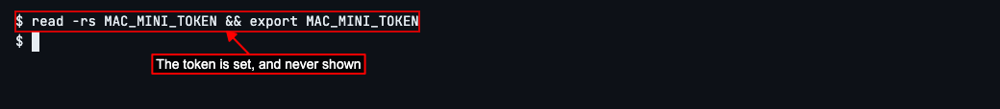
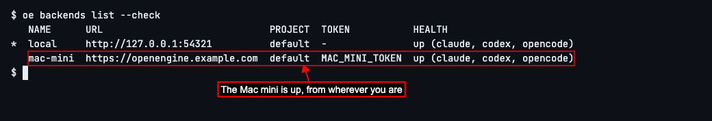
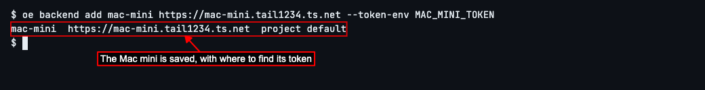
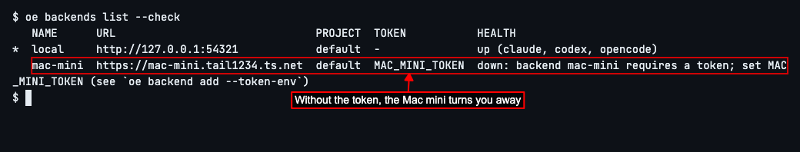
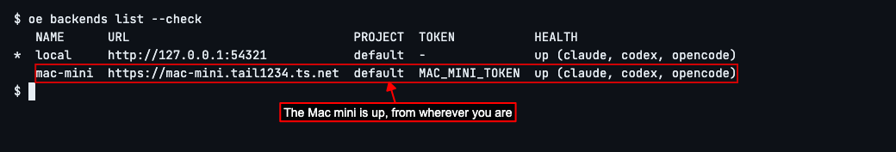

# Reach Your OpenEngine From Anywhere

## Cloudflare Tunnel

### Reach it through Cloudflare Tunnel


OpenEngine is a tool that has AI coding agents work on your code, step by step, in the way you lay out. If it runs on a Mac mini, or another computer that stays on all day, you can use it from your laptop wherever you are: at the office, at a café, or travelling. This guide shows how to do that safely, over https, with one of two free tools. Use whichever suits you.

**Cloudflare Tunnel** gives the Mac mini an address on a domain of your own, such as `https://openengine.example.com`, that you can reach from anywhere. Nothing on your home network has to be opened up. You'll need a Cloudflare account with your domain added to it.


On the Mac mini, install `cloudflared`, Cloudflare's tunnel program. With [Homebrew](https://brew.sh), type `brew install cloudflared`; for other ways, see [Cloudflare's downloads](https://developers.cloudflare.com/cloudflare-one/connections/connect-networks/downloads/). Run `cloudflared --version` afterwards: it should print `cloudflared version` followed by a version number.


Sign in to Cloudflare. Type `cloudflared tunnel login` and press Enter. A browser window opens: sign in, and choose the domain the Mac mini's address will be on. Return to the terminal and look for `You have successfully logged in`. If it does not appear, complete the browser sign-in before continuing.


Create a tunnel for OpenEngine. Type `cloudflared tunnel create openengine` and press Enter. A **tunnel** is a private way in from Cloudflare to the Mac mini, which the Mac mini opens itself. Look for `Created tunnel openengine with id` followed by a long identifier.


Give the tunnel its address. Type `cloudflared tunnel route dns openengine openengine.example.com` and press Enter, with your own domain in place of `example.com`. Look for `Added CNAME` followed by your hostname.


Before starting a tunnel, protect OpenEngine on the Mac mini with a **token**: a long, secret password that every request to it must carry. This matters. Keep OpenEngine private until this is set. A tunnel makes it reachable from outside your home network, and OpenEngine runs AI agents and commands on the Mac mini for whoever reaches it. With a token, anyone without it is turned away.

On the Mac mini, stop OpenEngine, make a token, and keep it in a file only you can read:

```sh
oe daemon stop
mkdir -p ~/.config/openengine
(umask 077; touch ~/.config/openengine/.env)
chmod 600 ~/.config/openengine/.env
printf 'ENGINE_SERVICE_TOKEN=%s\n' "$(openssl rand -hex 32)" >> ~/.config/openengine/.env
```

The commands finish without printing the secret. Type `ls -l ~/.config/openengine/.env`: the line must start with `-rw-------`, meaning only you can read it.


OpenEngine also only answers addresses it knows, so tell it the tunnel's. Open `~/.config/openengine/engine.toml` in a text editor and add this line at the top:

```toml
public_url = "https://openengine.example.com"
```


Start OpenEngine again with `oe daemon start`, then type `oe daemon status`. Look for `health: ready`; if it is missing, check the configuration line and start again.

For commands on the Mac mini, load the token into each new terminal before using OpenEngine:

```sh
set -a
. ~/.config/openengine/.env
set +a
```


To copy the token to this computer, type `grep ENGINE_SERVICE_TOKEN ~/.config/openengine/.env`. The output has this shape (your secret will be different):

```text
ENGINE_SERVICE_TOKEN=0123456789abcdef0123456789abcdef0123456789abcdef0123456789abcdef
```

Copy everything after the `=`. Keep it secret, as you would a password.


Start the tunnel, sending what arrives to OpenEngine. Type `cloudflared tunnel run --url http://127.0.0.1:4364 openengine` and press Enter. Look for `Registered tunnel connection`, which means Cloudflare is connected. If it is missing, check your sign-in and tunnel name. Leave that terminal open: the tunnel works while it's running. To have it start by itself, see [Cloudflare's guide to running a tunnel as a service](https://developers.cloudflare.com/cloudflare-one/connections/connect-networks/configure-tunnels/local-management/as-a-service/).


The tunnel is now running. For browser access on either computer, open `https://openengine.example.com`, including when you are sitting at the Mac mini. Choose sign in and paste the token you copied earlier. Closing the browser does not sign you out; use Sign out when you finish. If GitHub login is configured instead, sign in with GitHub.

If the page does not open, check that OpenEngine and the tunnel are running on the Mac mini before continuing.


Back on this computer, tell OpenEngine about the Mac mini: its name, its address, and the name of the place its token will be kept, `MAC_MINI_TOKEN`. Type `oe backend add mac-mini https://openengine.example.com --token-env MAC_MINI_TOKEN` and press Enter.

A **backend** is a computer where OpenEngine's background program is running, such as this one or the Mac mini. OpenEngine saves the Mac mini under the name `mac-mini`, with its address and `MAC_MINI_TOKEN` beside it. It never saves the token itself.



See the token at work before you give it to OpenEngine. Type `oe backends list --check` and press Enter.

Beside the Mac mini you'll see *down*, and that it *requires a token*: the Mac mini turned OpenEngine away, as it will anyone who doesn't have the token.



Now give this terminal the token. Type `read -rs MAC_MINI_TOKEN && export MAC_MINI_TOKEN` and press Enter, then paste the token and press Enter again.

Nothing shows while you paste, so the token never appears on your screen. The terminal keeps it until you close it; open a new terminal and you'll need to do this again.



Check that OpenEngine can reach the Mac mini now. Type `oe backends list --check` and press Enter.

You'll see *up* beside the Mac mini, followed by the agents it can use there. An agent is an AI coding assistant, such as Claude Code, that reads and changes code for you.

If you still see *requires a token*, the token you pasted isn't the Mac mini's: copy it again, and run the `read` command again. If you see *down* for another reason, check that the Mac mini is on, that OpenEngine and the tunnel are running on it, and that you typed its address correctly.



Next, send your commands to the Mac mini: see [Use OpenEngine on Another Computer](./test2doc-use-openengine-on-another-computer.mdx), from the step where you switch to it.


## Tailscale

### Reach it through Tailscale


**Tailscale** joins your own computers into a private network of their own, called a **tailnet**, wherever each of them is. Only computers signed in to your tailnet can reach the Mac mini, and it gets an https address there, such as `https://mac-mini.tail1234.ts.net`. You don't need a domain.


Install Tailscale on both computers, the Mac mini and this one, from [Tailscale's downloads](https://tailscale.com/download).


Sign in to Tailscale on both computers, with the same account, so they join the same tailnet. Then turn on https for your tailnet: see [Enabling HTTPS](https://tailscale.com/kb/1153/enabling-https). In Tailscale's admin console, open the Machines page, choose the Mac mini, and copy its full DNS name. Put `https://` in front of it: that is your address. Use it wherever this guide shows `https://mac-mini.tail1234.ts.net`.


Before starting a tunnel, protect OpenEngine on the Mac mini with a **token**: a long, secret password that every request to it must carry. This matters. Keep OpenEngine private until this is set. A tunnel makes it reachable from outside your home network, and OpenEngine runs AI agents and commands on the Mac mini for whoever reaches it. With a token, anyone without it is turned away.

On the Mac mini, stop OpenEngine, make a token, and keep it in a file only you can read:

```sh
oe daemon stop
mkdir -p ~/.config/openengine
(umask 077; touch ~/.config/openengine/.env)
chmod 600 ~/.config/openengine/.env
printf 'ENGINE_SERVICE_TOKEN=%s\n' "$(openssl rand -hex 32)" >> ~/.config/openengine/.env
```

The commands finish without printing the secret. Type `ls -l ~/.config/openengine/.env`: the line must start with `-rw-------`, meaning only you can read it.


OpenEngine also only answers addresses it knows, so tell it the tunnel's. Open `~/.config/openengine/engine.toml` in a text editor and add this line at the top:

```toml
public_url = "https://mac-mini.tail1234.ts.net"
```


Start OpenEngine again with `oe daemon start`, then type `oe daemon status`. Look for `health: ready`; if it is missing, check the configuration line and start again.

For commands on the Mac mini, load the token into each new terminal before using OpenEngine:

```sh
set -a
. ~/.config/openengine/.env
set +a
```


To copy the token to this computer, type `grep ENGINE_SERVICE_TOKEN ~/.config/openengine/.env`. The output has this shape (your secret will be different):

```text
ENGINE_SERVICE_TOKEN=0123456789abcdef0123456789abcdef0123456789abcdef0123456789abcdef
```

Copy everything after the `=`. Keep it secret, as you would a password.


On the Mac mini, give OpenEngine an https address on your tailnet. Type `tailscale serve --bg 4364` and press Enter. Look for `Available within your tailnet` and the address, such as `https://mac-mini.tail1234.ts.net`. Tailscale keeps serving it, even after a restart, until you type `tailscale serve reset`.


The tunnel is now running. For browser access on either computer, open `https://mac-mini.tail1234.ts.net`, including when you are sitting at the Mac mini. Choose sign in and paste the token you copied earlier. Closing the browser does not sign you out; use Sign out when you finish. If GitHub login is configured instead, sign in with GitHub.

If the page does not open, check that OpenEngine and the tunnel are running on the Mac mini before continuing.


Back on this computer, tell OpenEngine about the Mac mini: its name, its address, and the name of the place its token will be kept, `MAC_MINI_TOKEN`. Type `oe backend add mac-mini https://mac-mini.tail1234.ts.net --token-env MAC_MINI_TOKEN` and press Enter.

A **backend** is a computer where OpenEngine's background program is running, such as this one or the Mac mini. OpenEngine saves the Mac mini under the name `mac-mini`, with its address and `MAC_MINI_TOKEN` beside it. It never saves the token itself.



See the token at work before you give it to OpenEngine. Type `oe backends list --check` and press Enter.

Beside the Mac mini you'll see *down*, and that it *requires a token*: the Mac mini turned OpenEngine away, as it will anyone who doesn't have the token.



Now give this terminal the token. Type `read -rs MAC_MINI_TOKEN && export MAC_MINI_TOKEN` and press Enter, then paste the token and press Enter again.

Nothing shows while you paste, so the token never appears on your screen. The terminal keeps it until you close it; open a new terminal and you'll need to do this again.


Check that OpenEngine can reach the Mac mini now. Type `oe backends list --check` and press Enter.

You'll see *up* beside the Mac mini, followed by the agents it can use there. An agent is an AI coding assistant, such as Claude Code, that reads and changes code for you.

If you still see *requires a token*, the token you pasted isn't the Mac mini's: copy it again, and run the `read` command again. If you see *down* for another reason, check that the Mac mini is on, that OpenEngine and the tunnel are running on it, and that you typed its address correctly.



Next, send your commands to the Mac mini: see [Use OpenEngine on Another Computer](./test2doc-use-openengine-on-another-computer.mdx), from the step where you switch to it.


