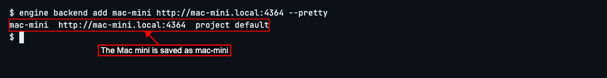
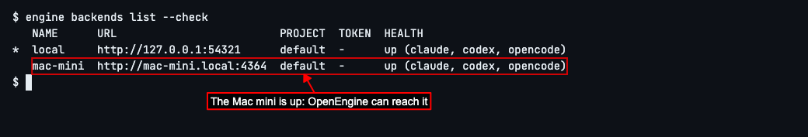
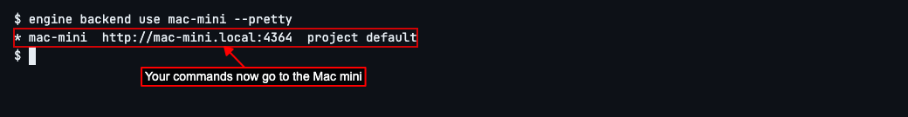
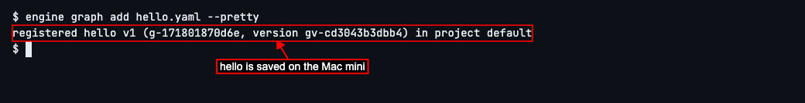
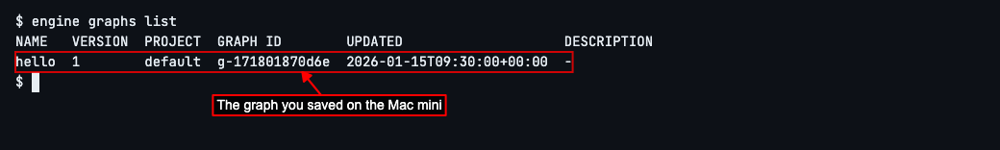
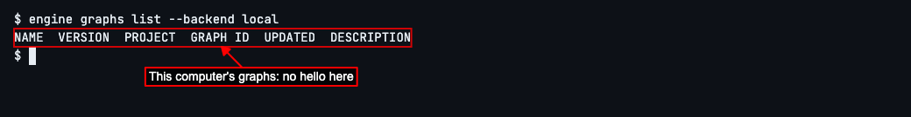
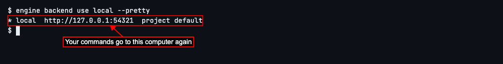

# Use OpenEngine on Another Computer

## Add a Mac mini and choose which computer to use

OpenEngine is a tool that has AI coding agents work on your code, step by step, in the way you lay out. It has a background program that does the work, and that program can run on more than one computer: this one, and another such as a Mac mini that stays on all day. Each computer it runs on is called a **backend**. The one on this computer is called `local`, and it's there from the start.

This guide shows how to tell OpenEngine about another computer, check you can reach it, and choose which computer your `engine` commands go to. You'll need OpenEngine already running on the other computer, and an address that reaches it from this one. Here, it's `http://mac-mini.local:4364`.

OpenEngine on the other computer only answers programs on that computer itself, so it needs a safe way in from this one, such as a private network between your computers (Tailscale is one) or an SSH tunnel. If someone else set up the Mac mini, ask them for the address that reaches it from here.

Give the other computer a name and tell OpenEngine its address. Type `engine backend add mac-mini http://mac-mini.local:4364 --pretty` and press Enter. Adding `--pretty` to a command asks for plain lines you can read, rather than the format other programs read.

OpenEngine saves the Mac mini under the name `mac-mini` and shows what it saved: the name, the address, and a project setting you can leave alone. Your commands still go to this computer for now.

Your commands reach the Mac mini over your network, along with OpenEngine's password (its *token*), which lets them in. An address starting `http://` sends both without encryption, so only use one on a network you trust, such as your home network.

OpenEngine sends the token this computer uses. If the Mac mini was given a token of its own, store it on this computer as a setting with a name you choose, such as `MAC_MINI_TOKEN`, and add `--token-env MAC_MINI_TOKEN` to the command above, so OpenEngine sends that one to the Mac mini instead.

Check that OpenEngine can reach it. Type `engine backends list --check` and press Enter.

You'll see every computer OpenEngine knows about, with *up* beside each one it could reach, followed by the agents it can use there. An agent is an AI coding assistant, such as Claude Code, that reads and changes code for you. The star marks the computer your commands go to: still `local`. You can leave the other columns alone for now.

If you see *down* beside the Mac mini instead, check that it's switched on, that OpenEngine is running on it, that the private network or tunnel to it is working, and that you typed its address correctly. If it says the Mac mini *requires a token*, it was given a token of its own: add the Mac mini again with `--token-env`, as above.

Switch to the Mac mini, so your commands go there from now on. Type `engine backend use mac-mini --pretty` and press Enter.

OpenEngine shows the computer you switched to, with a star to say your commands go there now.

Each computer keeps its own graphs: recipes for a piece of work, saying its steps, which agent does each one, and in what order. To see that your commands now go to the Mac mini, save a graph there. Here, your project has one in a file called `hello.yaml`. Type `engine graph add hello.yaml --pretty` and press Enter.

OpenEngine saves the graph, called `hello`, on the Mac mini. The screen says *registered*, OpenEngine's word for saved, followed by labels OpenEngine uses to tell graphs and their versions apart, and the project it's saved under. You can leave those alone.

Type `engine graphs list` and press Enter.

You'll see the Mac mini's graphs, with `hello` among them.

To use another computer for a single command without switching, add `--backend` and its name. Type `engine graphs list --backend local` and press Enter.

You'll see this computer's graphs instead, and `hello` isn't among them: you saved it on the Mac mini. Your other commands still go to the Mac mini.

When you want your commands to go to this computer again, switch back the same way. Type `engine backend use local --pretty` and press Enter.

OpenEngine shows `local` with the star: your commands go to this computer again.

Next, to see every option for adding, checking and switching computers, read [the `engine backend` commands](../../cli-reference.md#engine-backend) in the command reference.

