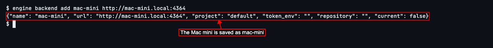
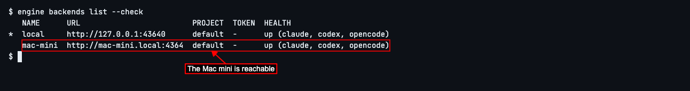
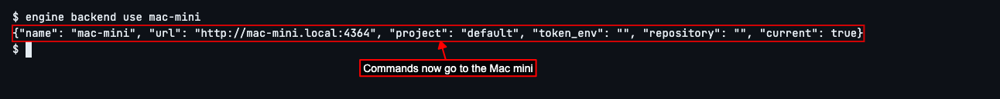
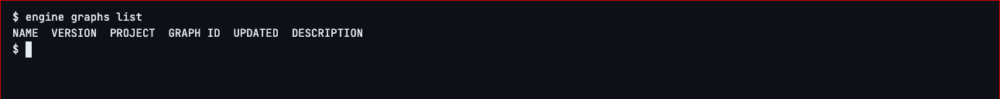
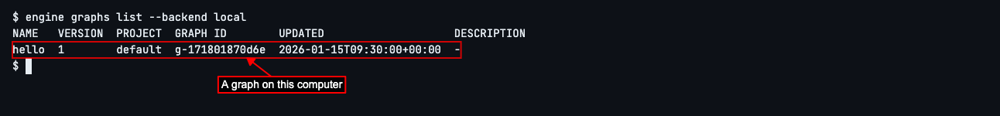
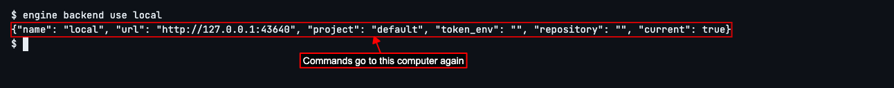

# Use OpenEngine on Another Computer

## Add a Mac mini and switch between computers

OpenEngine has AI coding agents work on your code, step by step, in the way you lay out. Its background program can run on more than one computer: this one, and another such as a Mac mini that stays on all day. Each computer it runs on is called a **backend**. The one on this computer is called `local`, and it's there from the start.

This guide shows how to tell OpenEngine about another computer, check you can reach it, and choose which computer your `engine` commands go to. You'll need OpenEngine running on the other computer already, and its address: here, `http://mac-mini.local:4364`.
Give the other computer a name and tell OpenEngine its address. Type `engine backend add mac-mini http://mac-mini.local:4364` and press Enter.

OpenEngine remembers the Mac mini under the name `mac-mini`, and shows what it saved.

Check that OpenEngine can reach it. Type `engine backends list --check` and press Enter.

You'll see every computer OpenEngine knows about, with *up* beside each one it could reach. The star shows the one your commands go to now: still `local`.

If you see *down* beside the Mac mini instead, check that it's switched on, that OpenEngine is running on it, and that you typed its address correctly.

Switch to the Mac mini, so your commands go there from now on. Type `engine backend use mac-mini` and press Enter.

OpenEngine shows the computer you switched to.

Graphs are OpenEngine's recipes for a piece of work: its steps, which agent does each one, and in what order. Each computer keeps its own. Type `engine graphs list` and press Enter.

You'll see the Mac mini's graphs. It has none yet, so the list is empty, even though this computer has one.

To use a different computer for a single command, without switching, add `--backend` and its name to the end. Type `engine graphs list --backend local` and press Enter.

You'll see this computer's graphs. Your other commands still go to the Mac mini.

When you want your commands to go to this computer again, switch back the same way. Type `engine backend use local` and press Enter.

Next, to see everything else you can do with the `engine` command, read **Getting Help**.

