# cxn: b207082af454

scope connections and add ingress routes



## Changes from 0a34e647834f

```diff
--- 0a34e647834f
+++ b207082af454
@@ -1,9 +1,17 @@
-CREATE TABLE connections (
+CREATE TABLE connection_routes (
+   provider VARCHAR(64) NOT NULL,
+   external_id VARCHAR(255) NOT NULL,
+   tenant_id CHAR(32) NOT NULL,
+   PRIMARY KEY (provider, external_id)
+);
+
+CREATE TABLE "connections" (
    id VARCHAR(36) NOT NULL,
    provider VARCHAR(64) NOT NULL,
    external_id VARCHAR(255) NOT NULL,
    name VARCHAR(255) NOT NULL,
    created_at DATETIME NOT NULL,
-   PRIMARY KEY (id),
-   CONSTRAINT uq_connections_provider_external_id UNIQUE (provider, external_id)
+   tenant_id CHAR(32) NOT NULL,
+   CONSTRAINT pk_connections PRIMARY KEY (tenant_id, id),
+   CONSTRAINT uq_connections_provider_external_id UNIQUE (tenant_id, provider, external_id)
 );
```

## Schema

```sql
CREATE TABLE connection_routes (
    provider VARCHAR(64) NOT NULL,
    external_id VARCHAR(255) NOT NULL,
    tenant_id CHAR(32) NOT NULL,
    PRIMARY KEY (provider, external_id)
);

CREATE TABLE "connections" (
    id VARCHAR(36) NOT NULL,
    provider VARCHAR(64) NOT NULL,
    external_id VARCHAR(255) NOT NULL,
    name VARCHAR(255) NOT NULL,
    created_at DATETIME NOT NULL,
    tenant_id CHAR(32) NOT NULL,
    CONSTRAINT pk_connections PRIMARY KEY (tenant_id, id),
    CONSTRAINT uq_connections_provider_external_id UNIQUE (tenant_id, provider, external_id)
);
```
