# ge: 4925ef9f3b79

add graph revisions, operations and command receipts



## Changes from b552e26457cd

```diff
--- b552e26457cd
+++ 4925ef9f3b79
@@ -1,9 +1,44 @@
+CREATE TABLE command_receipts (
+   command_id VARCHAR(128) NOT NULL,
+   subject VARCHAR(255) NOT NULL,
+   fingerprint VARCHAR(64) NOT NULL,
+   response JSON NOT NULL,
+   created_at DATETIME NOT NULL,
+   PRIMARY KEY (command_id)
+);
+
+CREATE TABLE graph_revisions (
+   graph_id VARCHAR(128) NOT NULL,
+   revision INTEGER NOT NULL,
+   format VARCHAR(16) NOT NULL,
+   source TEXT NOT NULL,
+   source_sha256 VARCHAR(64) NOT NULL,
+   created_at DATETIME NOT NULL,
+   PRIMARY KEY (graph_id, revision),
+   FOREIGN KEY(graph_id) REFERENCES graphs (graph_id)
+);
+
 CREATE TABLE graphs (
-   id VARCHAR(36) NOT NULL,
-   name VARCHAR(255) NOT NULL,
-   version INTEGER NOT NULL,
-   definition JSON NOT NULL,
+   graph_id VARCHAR(128) NOT NULL,
+   name VARCHAR(64) NOT NULL,
+   description VARCHAR(2000),
+   latest_revision INTEGER NOT NULL,
    created_at DATETIME NOT NULL,
-   PRIMARY KEY (id),
-   CONSTRAINT uq_graphs_name_version UNIQUE (name, version)
+   updated_at DATETIME NOT NULL,
+   PRIMARY KEY (graph_id),
+   CONSTRAINT uq_graphs_name UNIQUE (name)
 );
+
+CREATE TABLE operations (
+   operation_id VARCHAR(128) NOT NULL,
+   command_id VARCHAR(128) NOT NULL,
+   operation VARCHAR(64) NOT NULL,
+   status VARCHAR(16) NOT NULL,
+   resources JSON NOT NULL,
+   result JSON,
+   error JSON,
+   created_at DATETIME NOT NULL,
+   updated_at DATETIME NOT NULL,
+   PRIMARY KEY (operation_id),
+   CONSTRAINT uq_operations_command_id UNIQUE (command_id)
+);
```

## Schema

```sql
CREATE TABLE command_receipts (
    command_id VARCHAR(128) NOT NULL,
    subject VARCHAR(255) NOT NULL,
    fingerprint VARCHAR(64) NOT NULL,
    response JSON NOT NULL,
    created_at DATETIME NOT NULL,
    PRIMARY KEY (command_id)
);

CREATE TABLE graph_revisions (
    graph_id VARCHAR(128) NOT NULL,
    revision INTEGER NOT NULL,
    format VARCHAR(16) NOT NULL,
    source TEXT NOT NULL,
    source_sha256 VARCHAR(64) NOT NULL,
    created_at DATETIME NOT NULL,
    PRIMARY KEY (graph_id, revision),
    FOREIGN KEY(graph_id) REFERENCES graphs (graph_id)
);

CREATE TABLE graphs (
    graph_id VARCHAR(128) NOT NULL,
    name VARCHAR(64) NOT NULL,
    description VARCHAR(2000),
    latest_revision INTEGER NOT NULL,
    created_at DATETIME NOT NULL,
    updated_at DATETIME NOT NULL,
    PRIMARY KEY (graph_id),
    CONSTRAINT uq_graphs_name UNIQUE (name)
);

CREATE TABLE operations (
    operation_id VARCHAR(128) NOT NULL,
    command_id VARCHAR(128) NOT NULL,
    operation VARCHAR(64) NOT NULL,
    status VARCHAR(16) NOT NULL,
    resources JSON NOT NULL,
    result JSON,
    error JSON,
    created_at DATETIME NOT NULL,
    updated_at DATETIME NOT NULL,
    PRIMARY KEY (operation_id),
    CONSTRAINT uq_operations_command_id UNIQUE (command_id)
);
```
