# ge: 5cce010cee3d

scope GE tables to tenants



## Changes from d75ffe6cc5ed

```diff
--- d75ffe6cc5ed
+++ 5cce010cee3d
@@ -1,25 +1,28 @@
 CREATE TABLE "command_receipts" (
+   tenant_id CHAR(32) NOT NULL,
    project VARCHAR(64) NOT NULL,
    command_id VARCHAR(128) NOT NULL,
    subject VARCHAR(255) NOT NULL,
    fingerprint VARCHAR(64) NOT NULL,
    response JSON NOT NULL,
    created_at DATETIME NOT NULL,
-   PRIMARY KEY (project, command_id)
+   PRIMARY KEY (tenant_id, project, command_id)
 );

-CREATE TABLE graph_revisions (
+CREATE TABLE "graph_revisions" (
+   tenant_id CHAR(32) NOT NULL,
    graph_id VARCHAR(128) NOT NULL,
    revision INTEGER NOT NULL,
    format VARCHAR(16) NOT NULL,
    source TEXT NOT NULL,
    source_sha256 VARCHAR(64) NOT NULL,
    created_at DATETIME NOT NULL,
-   PRIMARY KEY (graph_id, revision),
-   FOREIGN KEY(graph_id) REFERENCES graphs (graph_id)
+   PRIMARY KEY (tenant_id, graph_id, revision),
+   FOREIGN KEY(tenant_id, graph_id) REFERENCES "graphs" (tenant_id, graph_id)
 );

 CREATE TABLE "graphs" (
+   tenant_id CHAR(32) NOT NULL,
    graph_id VARCHAR(128) NOT NULL,
    name VARCHAR(64) NOT NULL,
    description VARCHAR(2000),
@@ -27,11 +30,12 @@
    created_at DATETIME NOT NULL,
    updated_at DATETIME NOT NULL,
    project VARCHAR(64) NOT NULL,
-   PRIMARY KEY (graph_id),
-   CONSTRAINT uq_graphs_project_name UNIQUE (project, name)
+   PRIMARY KEY (tenant_id, graph_id),
+   CONSTRAINT uq_graphs_project_name UNIQUE (tenant_id, project, name)
 );

 CREATE TABLE "operations" (
+   tenant_id CHAR(32) NOT NULL,
    operation_id VARCHAR(128) NOT NULL,
    command_id VARCHAR(128) NOT NULL,
    operation VARCHAR(64) NOT NULL,
@@ -42,6 +46,6 @@
    created_at DATETIME NOT NULL,
    updated_at DATETIME NOT NULL,
    project VARCHAR(64) NOT NULL,
-   PRIMARY KEY (operation_id),
-   CONSTRAINT uq_operations_project_command_id UNIQUE (project, command_id)
+   PRIMARY KEY (tenant_id, operation_id),
+   CONSTRAINT uq_operations_project_command_id UNIQUE (tenant_id, project, command_id)
 );
```

## Schema

```sql
CREATE TABLE "command_receipts" (
    tenant_id CHAR(32) NOT NULL,
    project VARCHAR(64) NOT NULL,
    command_id VARCHAR(128) NOT NULL,
    subject VARCHAR(255) NOT NULL,
    fingerprint VARCHAR(64) NOT NULL,
    response JSON NOT NULL,
    created_at DATETIME NOT NULL,
    PRIMARY KEY (tenant_id, project, command_id)
);

CREATE TABLE "graph_revisions" (
    tenant_id CHAR(32) NOT NULL,
    graph_id VARCHAR(128) NOT NULL,
    revision INTEGER NOT NULL,
    format VARCHAR(16) NOT NULL,
    source TEXT NOT NULL,
    source_sha256 VARCHAR(64) NOT NULL,
    created_at DATETIME NOT NULL,
    PRIMARY KEY (tenant_id, graph_id, revision),
    FOREIGN KEY(tenant_id, graph_id) REFERENCES "graphs" (tenant_id, graph_id)
);

CREATE TABLE "graphs" (
    tenant_id CHAR(32) NOT NULL,
    graph_id VARCHAR(128) NOT NULL,
    name VARCHAR(64) NOT NULL,
    description VARCHAR(2000),
    latest_revision INTEGER NOT NULL,
    created_at DATETIME NOT NULL,
    updated_at DATETIME NOT NULL,
    project VARCHAR(64) NOT NULL,
    PRIMARY KEY (tenant_id, graph_id),
    CONSTRAINT uq_graphs_project_name UNIQUE (tenant_id, project, name)
);

CREATE TABLE "operations" (
    tenant_id CHAR(32) NOT NULL,
    operation_id VARCHAR(128) NOT NULL,
    command_id VARCHAR(128) NOT NULL,
    operation VARCHAR(64) NOT NULL,
    status VARCHAR(16) NOT NULL,
    resources JSON NOT NULL,
    result JSON,
    error JSON,
    created_at DATETIME NOT NULL,
    updated_at DATETIME NOT NULL,
    project VARCHAR(64) NOT NULL,
    PRIMARY KEY (tenant_id, operation_id),
    CONSTRAINT uq_operations_project_command_id UNIQUE (tenant_id, project, command_id)
);
```
