# ge: d75ffe6cc5ed

scope graphs and command receipts to projects



## Changes from 4925ef9f3b79

```diff
--- 4925ef9f3b79
+++ d75ffe6cc5ed
@@ -1,10 +1,11 @@
-CREATE TABLE command_receipts (
+CREATE TABLE "command_receipts" (
+   project VARCHAR(64) NOT NULL,
    command_id VARCHAR(128) NOT NULL,
    subject VARCHAR(255) NOT NULL,
    fingerprint VARCHAR(64) NOT NULL,
    response JSON NOT NULL,
    created_at DATETIME NOT NULL,
-   PRIMARY KEY (command_id)
+   PRIMARY KEY (project, command_id)
 );

 CREATE TABLE graph_revisions (
@@ -18,18 +19,19 @@
    FOREIGN KEY(graph_id) REFERENCES graphs (graph_id)
 );

-CREATE TABLE graphs (
+CREATE TABLE "graphs" (
    graph_id VARCHAR(128) NOT NULL,
    name VARCHAR(64) NOT NULL,
    description VARCHAR(2000),
    latest_revision INTEGER NOT NULL,
    created_at DATETIME NOT NULL,
    updated_at DATETIME NOT NULL,
+   project VARCHAR(64) NOT NULL,
    PRIMARY KEY (graph_id),
-   CONSTRAINT uq_graphs_name UNIQUE (name)
+   CONSTRAINT uq_graphs_project_name UNIQUE (project, name)
 );

-CREATE TABLE operations (
+CREATE TABLE "operations" (
    operation_id VARCHAR(128) NOT NULL,
    command_id VARCHAR(128) NOT NULL,
    operation VARCHAR(64) NOT NULL,
@@ -39,6 +41,7 @@
    error JSON,
    created_at DATETIME NOT NULL,
    updated_at DATETIME NOT NULL,
+   project VARCHAR(64) NOT NULL,
    PRIMARY KEY (operation_id),
-   CONSTRAINT uq_operations_command_id UNIQUE (command_id)
+   CONSTRAINT uq_operations_project_command_id UNIQUE (project, command_id)
 );
```

## Schema

```sql
CREATE TABLE "command_receipts" (
    project VARCHAR(64) NOT NULL,
    command_id VARCHAR(128) NOT NULL,
    subject VARCHAR(255) NOT NULL,
    fingerprint VARCHAR(64) NOT NULL,
    response JSON NOT NULL,
    created_at DATETIME NOT NULL,
    PRIMARY KEY (project, command_id)
);

CREATE TABLE graph_revisions (
    graph_id VARCHAR(128) NOT NULL,
    revision INTEGER NOT NULL,
    format VARCHAR(16) NOT NULL,
    source TEXT NOT NULL,
    source_sha256 VARCHAR(64) NOT NULL,
    created_at DATETIME NOT NULL,
    PRIMARY KEY (graph_id, revision),
    FOREIGN KEY(graph_id) REFERENCES graphs (graph_id)
);

CREATE TABLE "graphs" (
    graph_id VARCHAR(128) NOT NULL,
    name VARCHAR(64) NOT NULL,
    description VARCHAR(2000),
    latest_revision INTEGER NOT NULL,
    created_at DATETIME NOT NULL,
    updated_at DATETIME NOT NULL,
    project VARCHAR(64) NOT NULL,
    PRIMARY KEY (graph_id),
    CONSTRAINT uq_graphs_project_name UNIQUE (project, name)
);

CREATE TABLE "operations" (
    operation_id VARCHAR(128) NOT NULL,
    command_id VARCHAR(128) NOT NULL,
    operation VARCHAR(64) NOT NULL,
    status VARCHAR(16) NOT NULL,
    resources JSON NOT NULL,
    result JSON,
    error JSON,
    created_at DATETIME NOT NULL,
    updated_at DATETIME NOT NULL,
    project VARCHAR(64) NOT NULL,
    PRIMARY KEY (operation_id),
    CONSTRAINT uq_operations_project_command_id UNIQUE (project, command_id)
);
```
