# tools: 1f78d3a45137

tenant scope tool persistence



## Changes from 48be4be506f8

```diff
--- 48be4be506f8
+++ 1f78d3a45137
@@ -6,7 +6,7 @@

 CREATE INDEX ix_tools_connection_name ON tools (connection_name);

-CREATE TABLE policies (
+CREATE TABLE "policies" (
    uid VARCHAR(63) NOT NULL,
    namespace VARCHAR(63) NOT NULL,
    name VARCHAR(63) NOT NULL,
@@ -16,8 +16,9 @@
    policy TEXT NOT NULL,
    created_at DATETIME NOT NULL,
    updated_at DATETIME NOT NULL,
-   PRIMARY KEY (uid),
-   CONSTRAINT uq_policies_namespace_name UNIQUE (namespace, name)
+   tenant_id CHAR(32) NOT NULL,
+   CONSTRAINT pk_policies PRIMARY KEY (tenant_id, uid),
+   CONSTRAINT uq_policies_namespace_name UNIQUE (tenant_id, namespace, name)
 );

 CREATE TABLE "tool_grants" (
@@ -35,22 +36,24 @@
    created_at DATETIME NOT NULL,
    updated_at DATETIME NOT NULL,
    "when" TEXT,
-   PRIMARY KEY (uid),
-   CONSTRAINT uq_tool_grants_namespace_name UNIQUE (namespace, name)
+   tenant_id CHAR(32) NOT NULL,
+   CONSTRAINT pk_tool_grants PRIMARY KEY (tenant_id, uid),
+   CONSTRAINT uq_tool_grants_namespace_name UNIQUE (tenant_id, namespace, name)
 );

-CREATE TABLE tool_invocation_attempts (
+CREATE TABLE "tool_invocation_attempts" (
    invocation_uid VARCHAR(63) NOT NULL,
    number INTEGER NOT NULL,
    idempotency_key VARCHAR(128) NOT NULL,
    outcome VARCHAR(16),
    started_at DATETIME NOT NULL,
    finished_at DATETIME,
-   PRIMARY KEY (invocation_uid, number),
-   FOREIGN KEY(invocation_uid) REFERENCES tool_invocations (uid) ON DELETE CASCADE
+   tenant_id CHAR(32) NOT NULL,
+   CONSTRAINT pk_tool_invocation_attempts PRIMARY KEY (tenant_id, invocation_uid, number),
+   CONSTRAINT fk_tool_invocation_attempts_invocation_uid_tool_invocations FOREIGN KEY(tenant_id, invocation_uid) REFERENCES tool_invocations (tenant_id, uid) ON DELETE CASCADE
 );

-CREATE TABLE tool_invocations (
+CREATE TABLE "tool_invocations" (
    uid VARCHAR(63) NOT NULL,
    namespace VARCHAR(63) NOT NULL,
    name VARCHAR(63) NOT NULL,
@@ -71,11 +74,12 @@
    updated_at DATETIME NOT NULL,
    started_at DATETIME,
    completed_at DATETIME,
-   PRIMARY KEY (uid),
-   CONSTRAINT uq_tool_invocations_namespace_name UNIQUE (namespace, name)
+   tenant_id CHAR(32) NOT NULL,
+   CONSTRAINT pk_tool_invocations PRIMARY KEY (tenant_id, uid),
+   CONSTRAINT uq_tool_invocations_namespace_name UNIQUE (tenant_id, namespace, name)
 );

-CREATE TABLE tools (
+CREATE TABLE "tools" (
    uid VARCHAR(63) NOT NULL,
    namespace VARCHAR(63) NOT NULL,
    name VARCHAR(63) NOT NULL,
@@ -87,6 +91,7 @@
    phase VARCHAR(16) NOT NULL,
    created_at DATETIME NOT NULL,
    updated_at DATETIME NOT NULL,
-   PRIMARY KEY (uid),
-   CONSTRAINT uq_tools_namespace_name UNIQUE (namespace, name)
+   tenant_id CHAR(32) NOT NULL,
+   CONSTRAINT pk_tools PRIMARY KEY (tenant_id, uid),
+   CONSTRAINT uq_tools_namespace_name UNIQUE (tenant_id, namespace, name)
 );
```

## Schema

```sql
CREATE INDEX ix_tool_grants_subject ON tool_grants (namespace, workspace_name, tool_name);

CREATE INDEX ix_tool_invocations_caller ON tool_invocations (namespace, workspace_name, step_attempt_id);

CREATE INDEX ix_tool_invocations_phase ON tool_invocations (phase);

CREATE INDEX ix_tools_connection_name ON tools (connection_name);

CREATE TABLE "policies" (
    uid VARCHAR(63) NOT NULL,
    namespace VARCHAR(63) NOT NULL,
    name VARCHAR(63) NOT NULL,
    generation INTEGER NOT NULL,
    labels JSON NOT NULL,
    annotations JSON NOT NULL,
    policy TEXT NOT NULL,
    created_at DATETIME NOT NULL,
    updated_at DATETIME NOT NULL,
    tenant_id CHAR(32) NOT NULL,
    CONSTRAINT pk_policies PRIMARY KEY (tenant_id, uid),
    CONSTRAINT uq_policies_namespace_name UNIQUE (tenant_id, namespace, name)
);

CREATE TABLE "tool_grants" (
    uid VARCHAR(63) NOT NULL,
    namespace VARCHAR(63) NOT NULL,
    name VARCHAR(63) NOT NULL,
    generation INTEGER NOT NULL,
    labels JSON NOT NULL,
    annotations JSON NOT NULL,
    tool_name VARCHAR(63) NOT NULL,
    tool_uid VARCHAR(63) NOT NULL,
    workspace_name VARCHAR(63) NOT NULL,
    step_attempt_id VARCHAR(128),
    expires_at DATETIME,
    created_at DATETIME NOT NULL,
    updated_at DATETIME NOT NULL,
    "when" TEXT,
    tenant_id CHAR(32) NOT NULL,
    CONSTRAINT pk_tool_grants PRIMARY KEY (tenant_id, uid),
    CONSTRAINT uq_tool_grants_namespace_name UNIQUE (tenant_id, namespace, name)
);

CREATE TABLE "tool_invocation_attempts" (
    invocation_uid VARCHAR(63) NOT NULL,
    number INTEGER NOT NULL,
    idempotency_key VARCHAR(128) NOT NULL,
    outcome VARCHAR(16),
    started_at DATETIME NOT NULL,
    finished_at DATETIME,
    tenant_id CHAR(32) NOT NULL,
    CONSTRAINT pk_tool_invocation_attempts PRIMARY KEY (tenant_id, invocation_uid, number),
    CONSTRAINT fk_tool_invocation_attempts_invocation_uid_tool_invocations FOREIGN KEY(tenant_id, invocation_uid) REFERENCES tool_invocations (tenant_id, uid) ON DELETE CASCADE
);

CREATE TABLE "tool_invocations" (
    uid VARCHAR(63) NOT NULL,
    namespace VARCHAR(63) NOT NULL,
    name VARCHAR(63) NOT NULL,
    tool_name VARCHAR(63) NOT NULL,
    tool_uid VARCHAR(63) NOT NULL,
    tool_generation INTEGER NOT NULL,
    tool_spec JSON NOT NULL,
    workspace_name VARCHAR(63) NOT NULL,
    workspace_generation INTEGER NOT NULL,
    step_attempt_id VARCHAR(128) NOT NULL,
    arguments JSON NOT NULL,
    grant_refs JSON NOT NULL,
    phase VARCHAR(16) NOT NULL,
    attempt_count INTEGER NOT NULL,
    result JSON,
    error JSON,
    created_at DATETIME NOT NULL,
    updated_at DATETIME NOT NULL,
    started_at DATETIME,
    completed_at DATETIME,
    tenant_id CHAR(32) NOT NULL,
    CONSTRAINT pk_tool_invocations PRIMARY KEY (tenant_id, uid),
    CONSTRAINT uq_tool_invocations_namespace_name UNIQUE (tenant_id, namespace, name)
);

CREATE TABLE "tools" (
    uid VARCHAR(63) NOT NULL,
    namespace VARCHAR(63) NOT NULL,
    name VARCHAR(63) NOT NULL,
    generation INTEGER NOT NULL,
    labels JSON NOT NULL,
    annotations JSON NOT NULL,
    spec JSON NOT NULL,
    connection_name VARCHAR(64) NOT NULL,
    phase VARCHAR(16) NOT NULL,
    created_at DATETIME NOT NULL,
    updated_at DATETIME NOT NULL,
    tenant_id CHAR(32) NOT NULL,
    CONSTRAINT pk_tools PRIMARY KEY (tenant_id, uid),
    CONSTRAINT uq_tools_namespace_name UNIQUE (tenant_id, namespace, name)
);
```
