# tools: 48be4be506f8

grant when and ceiling policies



## Changes from 01c7cfcaaab7

```diff
--- 01c7cfcaaab7
+++ 48be4be506f8
@@ -6,7 +6,21 @@

 CREATE INDEX ix_tools_connection_name ON tools (connection_name);

-CREATE TABLE tool_grants (
+CREATE TABLE policies (
+   uid VARCHAR(63) NOT NULL,
+   namespace VARCHAR(63) NOT NULL,
+   name VARCHAR(63) NOT NULL,
+   generation INTEGER NOT NULL,
+   labels JSON NOT NULL,
+   annotations JSON NOT NULL,
+   policy TEXT NOT NULL,
+   created_at DATETIME NOT NULL,
+   updated_at DATETIME NOT NULL,
+   PRIMARY KEY (uid),
+   CONSTRAINT uq_policies_namespace_name UNIQUE (namespace, name)
+);
+
+CREATE TABLE "tool_grants" (
    uid VARCHAR(63) NOT NULL,
    namespace VARCHAR(63) NOT NULL,
    name VARCHAR(63) NOT NULL,
@@ -17,10 +31,10 @@
    tool_uid VARCHAR(63) NOT NULL,
    workspace_name VARCHAR(63) NOT NULL,
    step_attempt_id VARCHAR(128),
-   constraints JSON NOT NULL,
    expires_at DATETIME,
    created_at DATETIME NOT NULL,
    updated_at DATETIME NOT NULL,
+   "when" TEXT,
    PRIMARY KEY (uid),
    CONSTRAINT uq_tool_grants_namespace_name UNIQUE (namespace, name)
 );
```

## Schema

```sql
CREATE INDEX ix_tool_grants_subject ON tool_grants (namespace, workspace_name, tool_name);

CREATE INDEX ix_tool_invocations_caller ON tool_invocations (namespace, workspace_name, step_attempt_id);

CREATE INDEX ix_tool_invocations_phase ON tool_invocations (phase);

CREATE INDEX ix_tools_connection_name ON tools (connection_name);

CREATE TABLE policies (
    uid VARCHAR(63) NOT NULL,
    namespace VARCHAR(63) NOT NULL,
    name VARCHAR(63) NOT NULL,
    generation INTEGER NOT NULL,
    labels JSON NOT NULL,
    annotations JSON NOT NULL,
    policy TEXT NOT NULL,
    created_at DATETIME NOT NULL,
    updated_at DATETIME NOT NULL,
    PRIMARY KEY (uid),
    CONSTRAINT uq_policies_namespace_name UNIQUE (namespace, name)
);

CREATE TABLE "tool_grants" (
    uid VARCHAR(63) NOT NULL,
    namespace VARCHAR(63) NOT NULL,
    name VARCHAR(63) NOT NULL,
    generation INTEGER NOT NULL,
    labels JSON NOT NULL,
    annotations JSON NOT NULL,
    tool_name VARCHAR(63) NOT NULL,
    tool_uid VARCHAR(63) NOT NULL,
    workspace_name VARCHAR(63) NOT NULL,
    step_attempt_id VARCHAR(128),
    expires_at DATETIME,
    created_at DATETIME NOT NULL,
    updated_at DATETIME NOT NULL,
    "when" TEXT,
    PRIMARY KEY (uid),
    CONSTRAINT uq_tool_grants_namespace_name UNIQUE (namespace, name)
);

CREATE TABLE tool_invocation_attempts (
    invocation_uid VARCHAR(63) NOT NULL,
    number INTEGER NOT NULL,
    idempotency_key VARCHAR(128) NOT NULL,
    outcome VARCHAR(16),
    started_at DATETIME NOT NULL,
    finished_at DATETIME,
    PRIMARY KEY (invocation_uid, number),
    FOREIGN KEY(invocation_uid) REFERENCES tool_invocations (uid) ON DELETE CASCADE
);

CREATE TABLE tool_invocations (
    uid VARCHAR(63) NOT NULL,
    namespace VARCHAR(63) NOT NULL,
    name VARCHAR(63) NOT NULL,
    tool_name VARCHAR(63) NOT NULL,
    tool_uid VARCHAR(63) NOT NULL,
    tool_generation INTEGER NOT NULL,
    tool_spec JSON NOT NULL,
    workspace_name VARCHAR(63) NOT NULL,
    workspace_generation INTEGER NOT NULL,
    step_attempt_id VARCHAR(128) NOT NULL,
    arguments JSON NOT NULL,
    grant_refs JSON NOT NULL,
    phase VARCHAR(16) NOT NULL,
    attempt_count INTEGER NOT NULL,
    result JSON,
    error JSON,
    created_at DATETIME NOT NULL,
    updated_at DATETIME NOT NULL,
    started_at DATETIME,
    completed_at DATETIME,
    PRIMARY KEY (uid),
    CONSTRAINT uq_tool_invocations_namespace_name UNIQUE (namespace, name)
);

CREATE TABLE tools (
    uid VARCHAR(63) NOT NULL,
    namespace VARCHAR(63) NOT NULL,
    name VARCHAR(63) NOT NULL,
    generation INTEGER NOT NULL,
    labels JSON NOT NULL,
    annotations JSON NOT NULL,
    spec JSON NOT NULL,
    connection_name VARCHAR(64) NOT NULL,
    phase VARCHAR(16) NOT NULL,
    created_at DATETIME NOT NULL,
    updated_at DATETIME NOT NULL,
    PRIMARY KEY (uid),
    CONSTRAINT uq_tools_namespace_name UNIQUE (namespace, name)
);
```
