# vcp: 1b2226fa7c9a

Persist steering commands and session event history



## Changes from cfed9cf520fd

```diff
--- cfed9cf520fd
+++ 1b2226fa7c9a
@@ -8,9 +8,17 @@

 CREATE INDEX ix_runtime_commands_pending ON runtime_commands (status) WHERE status = 'pending';

+CREATE INDEX ix_session_history_attempt ON session_history (session_id, attempt_id, sequence);
+
+CREATE INDEX ix_session_history_attempt_kind ON session_history (session_id, attempt_id, kind, sequence);
+
+CREATE INDEX ix_session_history_kind ON session_history (session_id, kind, sequence);
+
 CREATE INDEX ix_sessions_workspace_page ON sessions (json_extract(body, '$.snapshot.workspace_id'), json_extract(body, '$.snapshot.created_at'), key);

 CREATE INDEX ix_sessions_workspace_state_page ON sessions (json_extract(body, '$.snapshot.workspace_id'), json_extract(body, '$.snapshot.state'), json_extract(body, '$.snapshot.created_at'), key);
+
+CREATE INDEX ix_steering_commands_pending ON steering_commands (json_extract(body, '$.target.attempt_id'), "key") WHERE json_extract(body, '$.status') = 'pending';

 CREATE INDEX ix_workspaces_job_page ON workspaces (json_extract(body, '$.snapshot.labels.job_id'), json_extract(body, '$.snapshot.created_at'), key) WHERE json_type(body, '$.snapshot') = 'object';

@@ -42,6 +50,12 @@
    PRIMARY KEY ("key")
 );

+CREATE TABLE history_cursors (
+   "key" VARCHAR(128) NOT NULL,
+   body JSON NOT NULL,
+   PRIMARY KEY ("key")
+);
+
 CREATE TABLE operations (
    "key" VARCHAR(128) NOT NULL,
    body JSON NOT NULL,
@@ -66,7 +80,7 @@
    acknowledgement BLOB,
    PRIMARY KEY (command_id),
    CONSTRAINT fk_runtime_commands_attempt_id_attempts FOREIGN KEY(attempt_id) REFERENCES attempts ("key"),
-   CONSTRAINT ck_runtime_commands_status CHECK (status IN ('pending', 'acknowledged', 'rejected', 'blocked'))
+   CONSTRAINT ck_runtime_commands_status CHECK (status IN ('pending', 'acknowledged', 'rejected', 'blocked', 'settled'))
 );

 CREATE TABLE runtime_status (
@@ -85,7 +99,24 @@
    FOREIGN KEY(runtime_id) REFERENCES runtime_status ("key")
 );

+CREATE TABLE session_history (
+   session_id VARCHAR(128) NOT NULL,
+   sequence INTEGER NOT NULL,
+   kind VARCHAR(16) NOT NULL,
+   attempt_id VARCHAR(128) NOT NULL,
+   entry JSON NOT NULL,
+   PRIMARY KEY (session_id, sequence),
+   FOREIGN KEY(session_id) REFERENCES sessions ("key"),
+   FOREIGN KEY(attempt_id) REFERENCES attempts ("key")
+);
+
 CREATE TABLE sessions (
+   "key" VARCHAR(128) NOT NULL,
+   body JSON NOT NULL,
+   PRIMARY KEY ("key")
+);
+
+CREATE TABLE steering_commands (
    "key" VARCHAR(128) NOT NULL,
    body JSON NOT NULL,
    PRIMARY KEY ("key")
```

## Schema

```sql
CREATE INDEX ix_operations_active ON operations ("key") WHERE json_extract(body, '$.snapshot.status') IN ('pending', 'running');

CREATE UNIQUE INDEX ix_outbox_event_id ON outbox (event_id);

CREATE INDEX ix_outbox_pending ON outbox (sequence) WHERE published_at IS NULL;

CREATE INDEX ix_outbox_workspace_pending ON outbox (workspace_id, sequence) WHERE published_at IS NULL;

CREATE INDEX ix_runtime_commands_pending ON runtime_commands (status) WHERE status = 'pending';

CREATE INDEX ix_session_history_attempt ON session_history (session_id, attempt_id, sequence);

CREATE INDEX ix_session_history_attempt_kind ON session_history (session_id, attempt_id, kind, sequence);

CREATE INDEX ix_session_history_kind ON session_history (session_id, kind, sequence);

CREATE INDEX ix_sessions_workspace_page ON sessions (json_extract(body, '$.snapshot.workspace_id'), json_extract(body, '$.snapshot.created_at'), key);

CREATE INDEX ix_sessions_workspace_state_page ON sessions (json_extract(body, '$.snapshot.workspace_id'), json_extract(body, '$.snapshot.state'), json_extract(body, '$.snapshot.created_at'), key);

CREATE INDEX ix_steering_commands_pending ON steering_commands (json_extract(body, '$.target.attempt_id'), "key") WHERE json_extract(body, '$.status') = 'pending';

CREATE INDEX ix_workspaces_job_page ON workspaces (json_extract(body, '$.snapshot.labels.job_id'), json_extract(body, '$.snapshot.created_at'), key) WHERE json_type(body, '$.snapshot') = 'object';

CREATE INDEX ix_workspaces_legacy_status ON workspaces (json_extract(body, '$.legacy.status')) WHERE json_type(body, '$.legacy') = 'object';

CREATE INDEX ix_workspaces_name ON workspaces (json_extract(body, '$.snapshot.name'));

CREATE INDEX ix_workspaces_page ON workspaces (json_extract(body, '$.snapshot.created_at'), key) WHERE json_type(body, '$.snapshot') = 'object';

CREATE INDEX ix_workspaces_provider_page ON workspaces (json_extract(body, '$.snapshot.provider'), json_extract(body, '$.snapshot.created_at'), key) WHERE json_type(body, '$.snapshot') = 'object';

CREATE INDEX ix_workspaces_state_page ON workspaces (json_extract(body, '$.snapshot.state'), json_extract(body, '$.snapshot.created_at'), key) WHERE json_type(body, '$.snapshot') = 'object';

CREATE TABLE attempt_bindings (
    "key" VARCHAR(128) NOT NULL,
    body JSON NOT NULL,
    PRIMARY KEY ("key")
);

CREATE TABLE attempts (
    "key" VARCHAR(128) NOT NULL,
    body JSON NOT NULL,
    PRIMARY KEY ("key")
);

CREATE TABLE command_receipts (
    "key" VARCHAR(128) NOT NULL,
    body JSON NOT NULL,
    PRIMARY KEY ("key")
);

CREATE TABLE history_cursors (
    "key" VARCHAR(128) NOT NULL,
    body JSON NOT NULL,
    PRIMARY KEY ("key")
);

CREATE TABLE operations (
    "key" VARCHAR(128) NOT NULL,
    body JSON NOT NULL,
    PRIMARY KEY ("key")
);

CREATE TABLE outbox (
    sequence INTEGER NOT NULL PRIMARY KEY AUTOINCREMENT,
    workspace_id VARCHAR(128) NOT NULL,
    event_id VARCHAR(128) NOT NULL,
    envelope JSON NOT NULL,
    created_at DATETIME NOT NULL,
    published_at DATETIME
);

CREATE TABLE "runtime_commands" (
    command_id VARCHAR(128) NOT NULL,
    subject TEXT NOT NULL,
    wire BLOB NOT NULL,
    attempt_id VARCHAR(128) NOT NULL,
    status VARCHAR(16) DEFAULT 'pending' NOT NULL,
    acknowledgement BLOB,
    PRIMARY KEY (command_id),
    CONSTRAINT fk_runtime_commands_attempt_id_attempts FOREIGN KEY(attempt_id) REFERENCES attempts ("key"),
    CONSTRAINT ck_runtime_commands_status CHECK (status IN ('pending', 'acknowledged', 'rejected', 'blocked', 'settled'))
);

CREATE TABLE runtime_status (
    "key" VARCHAR(128) NOT NULL,
    body JSON NOT NULL,
    PRIMARY KEY ("key")
);

CREATE TABLE runtime_updates (
    runtime_id VARCHAR(128) NOT NULL,
    event_id VARCHAR(128) NOT NULL,
    sequence INTEGER NOT NULL,
    digest VARCHAR(64) NOT NULL,
    PRIMARY KEY (runtime_id, event_id),
    CONSTRAINT uq_runtime_updates_sequence UNIQUE (runtime_id, sequence),
    FOREIGN KEY(runtime_id) REFERENCES runtime_status ("key")
);

CREATE TABLE session_history (
    session_id VARCHAR(128) NOT NULL,
    sequence INTEGER NOT NULL,
    kind VARCHAR(16) NOT NULL,
    attempt_id VARCHAR(128) NOT NULL,
    entry JSON NOT NULL,
    PRIMARY KEY (session_id, sequence),
    FOREIGN KEY(session_id) REFERENCES sessions ("key"),
    FOREIGN KEY(attempt_id) REFERENCES attempts ("key")
);

CREATE TABLE sessions (
    "key" VARCHAR(128) NOT NULL,
    body JSON NOT NULL,
    PRIMARY KEY ("key")
);

CREATE TABLE steering_commands (
    "key" VARCHAR(128) NOT NULL,
    body JSON NOT NULL,
    PRIMARY KEY ("key")
);

CREATE TABLE workspace_runtimes (
    "key" VARCHAR(128) NOT NULL,
    body JSON NOT NULL,
    PRIMARY KEY ("key")
);

CREATE TABLE workspaces (
    "key" VARCHAR(128) NOT NULL,
    body JSON NOT NULL,
    PRIMARY KEY ("key")
);
```
