# vcp: 7c6330e71418

add durable control plane records



## Changes from d8f92154b5f7

```diff
--- d8f92154b5f7
+++ 7c6330e71418
@@ -1,4 +1,40 @@
 CREATE INDEX ix_workspaces_status ON workspaces (status);
+
+CREATE TABLE command_receipts (
+   "key" VARCHAR(128) NOT NULL,
+   body JSON NOT NULL,
+   PRIMARY KEY ("key")
+);
+
+CREATE TABLE cursors (
+   "key" VARCHAR(128) NOT NULL,
+   body JSON NOT NULL,
+   PRIMARY KEY ("key")
+);
+
+CREATE TABLE operations (
+   "key" VARCHAR(128) NOT NULL,
+   body JSON NOT NULL,
+   PRIMARY KEY ("key")
+);
+
+CREATE TABLE outbox (
+   "key" VARCHAR(128) NOT NULL,
+   body JSON NOT NULL,
+   PRIMARY KEY ("key")
+);
+
+CREATE TABLE runtime_ownership (
+   "key" VARCHAR(128) NOT NULL,
+   body JSON NOT NULL,
+   PRIMARY KEY ("key")
+);
+
+CREATE TABLE workspace_records (
+   "key" VARCHAR(128) NOT NULL,
+   body JSON NOT NULL,
+   PRIMARY KEY ("key")
+);

 CREATE TABLE workspaces (
    id VARCHAR(36) NOT NULL,
```

## Schema

```sql
CREATE INDEX ix_workspaces_status ON workspaces (status);

CREATE TABLE command_receipts (
    "key" VARCHAR(128) NOT NULL,
    body JSON NOT NULL,
    PRIMARY KEY ("key")
);

CREATE TABLE cursors (
    "key" VARCHAR(128) NOT NULL,
    body JSON NOT NULL,
    PRIMARY KEY ("key")
);

CREATE TABLE operations (
    "key" VARCHAR(128) NOT NULL,
    body JSON NOT NULL,
    PRIMARY KEY ("key")
);

CREATE TABLE outbox (
    "key" VARCHAR(128) NOT NULL,
    body JSON NOT NULL,
    PRIMARY KEY ("key")
);

CREATE TABLE runtime_ownership (
    "key" VARCHAR(128) NOT NULL,
    body JSON NOT NULL,
    PRIMARY KEY ("key")
);

CREATE TABLE workspace_records (
    "key" VARCHAR(128) NOT NULL,
    body JSON NOT NULL,
    PRIMARY KEY ("key")
);

CREATE TABLE workspaces (
    id VARCHAR(36) NOT NULL,
    provider VARCHAR(32) NOT NULL,
    status VARCHAR(32) NOT NULL,
    created_at DATETIME NOT NULL,
    updated_at DATETIME NOT NULL, locator JSON,
    PRIMARY KEY (id)
);
```
