# vcp: 86fd2767ba46

index workspace lookup and pages



## Changes from 65700680b119

```diff
--- 65700680b119
+++ 86fd2767ba46
@@ -6,7 +6,17 @@

 CREATE INDEX ix_outbox_workspace_pending ON outbox (workspace_id, sequence) WHERE published_at IS NULL;

+CREATE INDEX ix_workspaces_job_page ON workspaces (json_extract(body, '$.snapshot.labels.job_id'), json_extract(body, '$.snapshot.created_at'), key) WHERE json_type(body, '$.snapshot') = 'object';
+
 CREATE INDEX ix_workspaces_legacy_status ON workspaces (json_extract(body, '$.legacy.status')) WHERE json_type(body, '$.legacy') = 'object';
+
+CREATE INDEX ix_workspaces_name ON workspaces (json_extract(body, '$.snapshot.name'));
+
+CREATE INDEX ix_workspaces_page ON workspaces (json_extract(body, '$.snapshot.created_at'), key) WHERE json_type(body, '$.snapshot') = 'object';
+
+CREATE INDEX ix_workspaces_provider_page ON workspaces (json_extract(body, '$.snapshot.provider'), json_extract(body, '$.snapshot.created_at'), key) WHERE json_type(body, '$.snapshot') = 'object';
+
+CREATE INDEX ix_workspaces_state_page ON workspaces (json_extract(body, '$.snapshot.state'), json_extract(body, '$.snapshot.created_at'), key) WHERE json_type(body, '$.snapshot') = 'object';

 CREATE TABLE command_receipts (
    "key" VARCHAR(128) NOT NULL,
```

## Schema

```sql
CREATE INDEX ix_operations_pending ON operations ("key") WHERE json_extract(body, '$.snapshot.status') = 'pending';

CREATE UNIQUE INDEX ix_outbox_event_id ON outbox (event_id);

CREATE INDEX ix_outbox_pending ON outbox (sequence) WHERE published_at IS NULL;

CREATE INDEX ix_outbox_workspace_pending ON outbox (workspace_id, sequence) WHERE published_at IS NULL;

CREATE INDEX ix_workspaces_job_page ON workspaces (json_extract(body, '$.snapshot.labels.job_id'), json_extract(body, '$.snapshot.created_at'), key) WHERE json_type(body, '$.snapshot') = 'object';

CREATE INDEX ix_workspaces_legacy_status ON workspaces (json_extract(body, '$.legacy.status')) WHERE json_type(body, '$.legacy') = 'object';

CREATE INDEX ix_workspaces_name ON workspaces (json_extract(body, '$.snapshot.name'));

CREATE INDEX ix_workspaces_page ON workspaces (json_extract(body, '$.snapshot.created_at'), key) WHERE json_type(body, '$.snapshot') = 'object';

CREATE INDEX ix_workspaces_provider_page ON workspaces (json_extract(body, '$.snapshot.provider'), json_extract(body, '$.snapshot.created_at'), key) WHERE json_type(body, '$.snapshot') = 'object';

CREATE INDEX ix_workspaces_state_page ON workspaces (json_extract(body, '$.snapshot.state'), json_extract(body, '$.snapshot.created_at'), key) WHERE json_type(body, '$.snapshot') = 'object';

CREATE TABLE command_receipts (
    "key" VARCHAR(128) NOT NULL,
    body JSON NOT NULL,
    PRIMARY KEY ("key")
);

CREATE TABLE operations (
    "key" VARCHAR(128) NOT NULL,
    body JSON NOT NULL,
    PRIMARY KEY ("key")
);

CREATE TABLE outbox (
    sequence INTEGER NOT NULL PRIMARY KEY AUTOINCREMENT,
    workspace_id VARCHAR(128) NOT NULL,
    event_id VARCHAR(128) NOT NULL,
    envelope JSON NOT NULL,
    created_at DATETIME NOT NULL,
    published_at DATETIME
);

CREATE TABLE workspace_runtimes (
    "key" VARCHAR(128) NOT NULL,
    body JSON NOT NULL,
    PRIMARY KEY ("key")
);

CREATE TABLE workspaces (
    "key" VARCHAR(128) NOT NULL,
    body JSON NOT NULL,
    PRIMARY KEY ("key")
);
```
