# vcp: c36db826eebb

index pending outbox events by workspace



## Changes from 09a0811b905f

```diff
--- 09a0811b905f
+++ c36db826eebb
@@ -1,6 +1,8 @@
 CREATE UNIQUE INDEX ix_outbox_event_id ON outbox (event_id);

 CREATE INDEX ix_outbox_pending ON outbox (sequence) WHERE published_at IS NULL;
+
+CREATE INDEX ix_outbox_workspace_pending ON outbox (workspace_id, sequence) WHERE published_at IS NULL;

 CREATE INDEX ix_workspaces_legacy_status ON workspaces (json_extract(body, '$.legacy.status')) WHERE json_type(body, '$.legacy') = 'object';

```

## Schema

```sql
CREATE UNIQUE INDEX ix_outbox_event_id ON outbox (event_id);

CREATE INDEX ix_outbox_pending ON outbox (sequence) WHERE published_at IS NULL;

CREATE INDEX ix_outbox_workspace_pending ON outbox (workspace_id, sequence) WHERE published_at IS NULL;

CREATE INDEX ix_workspaces_legacy_status ON workspaces (json_extract(body, '$.legacy.status')) WHERE json_type(body, '$.legacy') = 'object';

CREATE TABLE command_receipts (
    "key" VARCHAR(128) NOT NULL,
    body JSON NOT NULL,
    PRIMARY KEY ("key")
);

CREATE TABLE operations (
    "key" VARCHAR(128) NOT NULL,
    body JSON NOT NULL,
    PRIMARY KEY ("key")
);

CREATE TABLE outbox (
    sequence INTEGER NOT NULL PRIMARY KEY AUTOINCREMENT,
    workspace_id VARCHAR(128) NOT NULL,
    event_id VARCHAR(128) NOT NULL,
    envelope JSON NOT NULL,
    created_at DATETIME NOT NULL,
    published_at DATETIME
);

CREATE TABLE workspace_runtimes (
    "key" VARCHAR(128) NOT NULL,
    body JSON NOT NULL,
    PRIMARY KEY ("key")
);

CREATE TABLE workspaces (
    "key" VARCHAR(128) NOT NULL,
    body JSON NOT NULL,
    PRIMARY KEY ("key")
);
```
