# vcp: cfed9cf520fd

track runtime command delivery and updates



## Changes from 9b7f1ac760d9

```diff
--- 9b7f1ac760d9
+++ cfed9cf520fd
@@ -5,6 +5,8 @@
 CREATE INDEX ix_outbox_pending ON outbox (sequence) WHERE published_at IS NULL;

 CREATE INDEX ix_outbox_workspace_pending ON outbox (workspace_id, sequence) WHERE published_at IS NULL;
+
+CREATE INDEX ix_runtime_commands_pending ON runtime_commands (command_id) WHERE status = 'pending';

 CREATE INDEX ix_sessions_workspace_page ON sessions (json_extract(body, '$.snapshot.workspace_id'), json_extract(body, '$.snapshot.created_at'), key);

@@ -58,11 +60,17 @@
 CREATE TABLE runtime_commands (
    command_id VARCHAR(128) NOT NULL,
    subject TEXT NOT NULL,
-   wire BLOB NOT NULL,
+   wire BLOB NOT NULL, status VARCHAR(16) DEFAULT 'pending' NOT NULL, acknowledgement BLOB,
    PRIMARY KEY (command_id)
 );

 CREATE TABLE runtime_status (
+   "key" VARCHAR(128) NOT NULL,
+   body JSON NOT NULL,
+   PRIMARY KEY ("key")
+);
+
+CREATE TABLE runtime_updates (
    "key" VARCHAR(128) NOT NULL,
    body JSON NOT NULL,
    PRIMARY KEY ("key")
```

## Schema

```sql
CREATE INDEX ix_operations_active ON operations ("key") WHERE json_extract(body, '$.snapshot.status') IN ('pending', 'running');

CREATE UNIQUE INDEX ix_outbox_event_id ON outbox (event_id);

CREATE INDEX ix_outbox_pending ON outbox (sequence) WHERE published_at IS NULL;

CREATE INDEX ix_outbox_workspace_pending ON outbox (workspace_id, sequence) WHERE published_at IS NULL;

CREATE INDEX ix_runtime_commands_pending ON runtime_commands (command_id) WHERE status = 'pending';

CREATE INDEX ix_sessions_workspace_page ON sessions (json_extract(body, '$.snapshot.workspace_id'), json_extract(body, '$.snapshot.created_at'), key);

CREATE INDEX ix_sessions_workspace_state_page ON sessions (json_extract(body, '$.snapshot.workspace_id'), json_extract(body, '$.snapshot.state'), json_extract(body, '$.snapshot.created_at'), key);

CREATE INDEX ix_workspaces_job_page ON workspaces (json_extract(body, '$.snapshot.labels.job_id'), json_extract(body, '$.snapshot.created_at'), key) WHERE json_type(body, '$.snapshot') = 'object';

CREATE INDEX ix_workspaces_legacy_status ON workspaces (json_extract(body, '$.legacy.status')) WHERE json_type(body, '$.legacy') = 'object';

CREATE INDEX ix_workspaces_name ON workspaces (json_extract(body, '$.snapshot.name'));

CREATE INDEX ix_workspaces_page ON workspaces (json_extract(body, '$.snapshot.created_at'), key) WHERE json_type(body, '$.snapshot') = 'object';

CREATE INDEX ix_workspaces_provider_page ON workspaces (json_extract(body, '$.snapshot.provider'), json_extract(body, '$.snapshot.created_at'), key) WHERE json_type(body, '$.snapshot') = 'object';

CREATE INDEX ix_workspaces_state_page ON workspaces (json_extract(body, '$.snapshot.state'), json_extract(body, '$.snapshot.created_at'), key) WHERE json_type(body, '$.snapshot') = 'object';

CREATE TABLE attempt_bindings (
    "key" VARCHAR(128) NOT NULL,
    body JSON NOT NULL,
    PRIMARY KEY ("key")
);

CREATE TABLE attempts (
    "key" VARCHAR(128) NOT NULL,
    body JSON NOT NULL,
    PRIMARY KEY ("key")
);

CREATE TABLE command_receipts (
    "key" VARCHAR(128) NOT NULL,
    body JSON NOT NULL,
    PRIMARY KEY ("key")
);

CREATE TABLE operations (
    "key" VARCHAR(128) NOT NULL,
    body JSON NOT NULL,
    PRIMARY KEY ("key")
);

CREATE TABLE outbox (
    sequence INTEGER NOT NULL PRIMARY KEY AUTOINCREMENT,
    workspace_id VARCHAR(128) NOT NULL,
    event_id VARCHAR(128) NOT NULL,
    envelope JSON NOT NULL,
    created_at DATETIME NOT NULL,
    published_at DATETIME
);

CREATE TABLE runtime_commands (
    command_id VARCHAR(128) NOT NULL,
    subject TEXT NOT NULL,
    wire BLOB NOT NULL, status VARCHAR(16) DEFAULT 'pending' NOT NULL, acknowledgement BLOB,
    PRIMARY KEY (command_id)
);

CREATE TABLE runtime_status (
    "key" VARCHAR(128) NOT NULL,
    body JSON NOT NULL,
    PRIMARY KEY ("key")
);

CREATE TABLE runtime_updates (
    "key" VARCHAR(128) NOT NULL,
    body JSON NOT NULL,
    PRIMARY KEY ("key")
);

CREATE TABLE sessions (
    "key" VARCHAR(128) NOT NULL,
    body JSON NOT NULL,
    PRIMARY KEY ("key")
);

CREATE TABLE workspace_runtimes (
    "key" VARCHAR(128) NOT NULL,
    body JSON NOT NULL,
    PRIMARY KEY ("key")
);

CREATE TABLE workspaces (
    "key" VARCHAR(128) NOT NULL,
    body JSON NOT NULL,
    PRIMARY KEY ("key")
);
```
