# vcp: fccebf44b080

add runtime delivery and daemon journals



## Changes from 6c4f1e3fd516

```diff
--- 6c4f1e3fd516
+++ fccebf44b080
@@ -19,6 +19,36 @@
 );

 CREATE TABLE cursors (
+   "key" VARCHAR(128) NOT NULL,
+   body JSON NOT NULL,
+   PRIMARY KEY ("key")
+);
+
+CREATE TABLE daemon_attempts (
+   "key" VARCHAR(128) NOT NULL,
+   body JSON NOT NULL,
+   PRIMARY KEY ("key")
+);
+
+CREATE TABLE daemon_commands (
+   "key" VARCHAR(128) NOT NULL,
+   body JSON NOT NULL,
+   PRIMARY KEY ("key")
+);
+
+CREATE TABLE daemon_meta (
+   "key" VARCHAR(128) NOT NULL,
+   body JSON NOT NULL,
+   PRIMARY KEY ("key")
+);
+
+CREATE TABLE daemon_sessions (
+   "key" VARCHAR(128) NOT NULL,
+   body JSON NOT NULL,
+   PRIMARY KEY ("key")
+);
+
+CREATE TABLE daemon_updates (
    "key" VARCHAR(128) NOT NULL,
    body JSON NOT NULL,
    PRIMARY KEY ("key")
@@ -48,6 +78,24 @@
    PRIMARY KEY ("key")
 );

+CREATE TABLE runtime_status (
+   "key" VARCHAR(128) NOT NULL,
+   body JSON NOT NULL,
+   PRIMARY KEY ("key")
+);
+
+CREATE TABLE runtime_updates (
+   "key" VARCHAR(128) NOT NULL,
+   body JSON NOT NULL,
+   PRIMARY KEY ("key")
+);
+
+CREATE TABLE session_history (
+   "key" VARCHAR(128) NOT NULL,
+   body JSON NOT NULL,
+   PRIMARY KEY ("key")
+);
+
 CREATE TABLE sessions (
    "key" VARCHAR(128) NOT NULL,
    body JSON NOT NULL,
```

## Schema

```sql
CREATE INDEX ix_workspaces_status ON workspaces (status);

CREATE TABLE attempt_bindings (
    "key" VARCHAR(128) NOT NULL,
    body JSON NOT NULL,
    PRIMARY KEY ("key")
);

CREATE TABLE attempts (
    "key" VARCHAR(128) NOT NULL,
    body JSON NOT NULL,
    PRIMARY KEY ("key")
);

CREATE TABLE command_receipts (
    "key" VARCHAR(128) NOT NULL,
    body JSON NOT NULL,
    PRIMARY KEY ("key")
);

CREATE TABLE cursors (
    "key" VARCHAR(128) NOT NULL,
    body JSON NOT NULL,
    PRIMARY KEY ("key")
);

CREATE TABLE daemon_attempts (
    "key" VARCHAR(128) NOT NULL,
    body JSON NOT NULL,
    PRIMARY KEY ("key")
);

CREATE TABLE daemon_commands (
    "key" VARCHAR(128) NOT NULL,
    body JSON NOT NULL,
    PRIMARY KEY ("key")
);

CREATE TABLE daemon_meta (
    "key" VARCHAR(128) NOT NULL,
    body JSON NOT NULL,
    PRIMARY KEY ("key")
);

CREATE TABLE daemon_sessions (
    "key" VARCHAR(128) NOT NULL,
    body JSON NOT NULL,
    PRIMARY KEY ("key")
);

CREATE TABLE daemon_updates (
    "key" VARCHAR(128) NOT NULL,
    body JSON NOT NULL,
    PRIMARY KEY ("key")
);

CREATE TABLE operations (
    "key" VARCHAR(128) NOT NULL,
    body JSON NOT NULL,
    PRIMARY KEY ("key")
);

CREATE TABLE outbox (
    "key" VARCHAR(128) NOT NULL,
    body JSON NOT NULL,
    PRIMARY KEY ("key")
);

CREATE TABLE runtime_outbox (
    "key" VARCHAR(128) NOT NULL,
    body JSON NOT NULL,
    PRIMARY KEY ("key")
);

CREATE TABLE runtime_ownership (
    "key" VARCHAR(128) NOT NULL,
    body JSON NOT NULL,
    PRIMARY KEY ("key")
);

CREATE TABLE runtime_status (
    "key" VARCHAR(128) NOT NULL,
    body JSON NOT NULL,
    PRIMARY KEY ("key")
);

CREATE TABLE runtime_updates (
    "key" VARCHAR(128) NOT NULL,
    body JSON NOT NULL,
    PRIMARY KEY ("key")
);

CREATE TABLE session_history (
    "key" VARCHAR(128) NOT NULL,
    body JSON NOT NULL,
    PRIMARY KEY ("key")
);

CREATE TABLE sessions (
    "key" VARCHAR(128) NOT NULL,
    body JSON NOT NULL,
    PRIMARY KEY ("key")
);

CREATE TABLE workspace_records (
    "key" VARCHAR(128) NOT NULL,
    body JSON NOT NULL,
    PRIMARY KEY ("key")
);

CREATE TABLE workspaces (
    id VARCHAR(36) NOT NULL,
    provider VARCHAR(32) NOT NULL,
    status VARCHAR(32) NOT NULL,
    created_at DATETIME NOT NULL,
    updated_at DATETIME NOT NULL,
    PRIMARY KEY (id)
);
```
